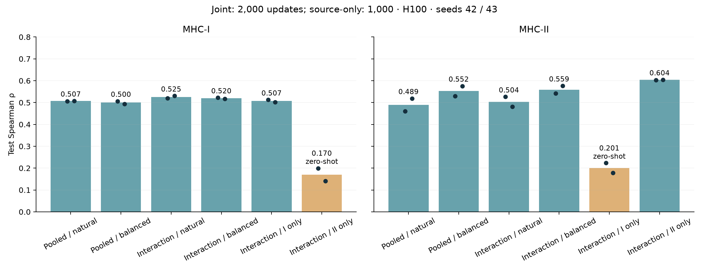
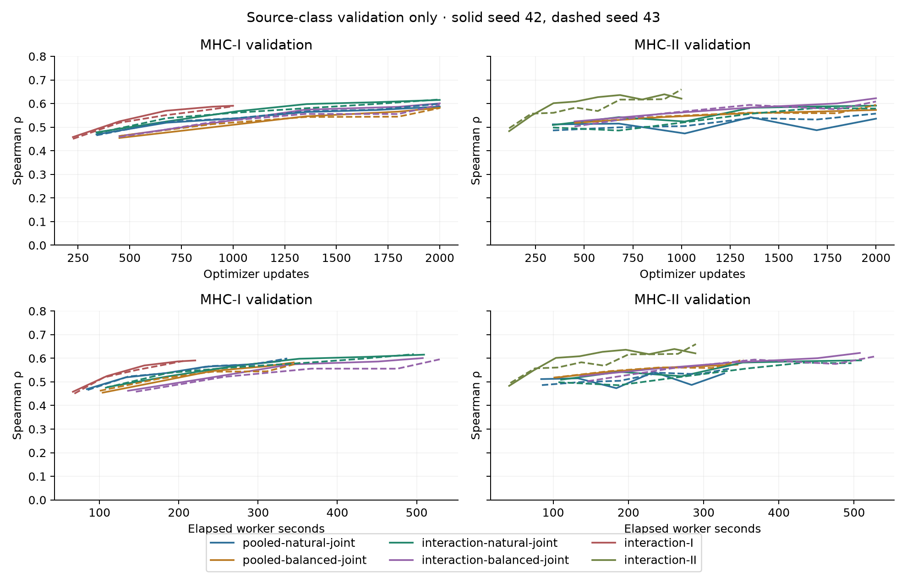

# Shared transfer improvements: experiment and integration

Completed October 27, 2026. Codex / GPT-6. All twelve fixed H100 fits, selected
validation/test predictions, independent metrics and fresh-H100 checkpoint replay.
No fit failed. Preferred condition: **interaction-natural-joint**, selected from
validation before new test metrics were inspected. Production promotion follows
that sealed decision, not test ranking.

## Results and decision

Two-seed means, not prediction ensembles; RMSE is log10(nM), lower is better.
† marks the opposite class with no target-class affinity training.
All four joint conditions use 2,000 updates; source-only conditions use 1,000.

| Condition | I val ρ / RMSE | I test ρ / RMSE | II val ρ / RMSE | II test ρ / RMSE |
|---|---:|---:|---:|---:|
| pooled-natural-joint | 0.5859 / 1.1362 | 0.5070 / 1.2030 | 0.5222 / 0.8657 | 0.4893 / 0.8092 |
| pooled-balanced-joint | 0.5733 / 1.1614 | 0.4998 / 1.2282 | 0.5813 / 0.8295 | 0.5524 / 0.7778 |
| interaction-natural-joint | 0.6115 / 1.1122 | 0.5248 / 1.1899 | 0.5832 / 0.8288 | 0.5039 / 0.8059 |
| interaction-balanced-joint | 0.5908 / 1.1475 | 0.5196 / 1.2067 | 0.6045 / 0.8157 | 0.5591 / 0.7823 |
| interaction-I | 0.5896 / 1.1357 | 0.5068 / 1.2112 | 0.2260 / 1.2226 † | 0.2010 / 1.2717 † |
| interaction-II | 0.2388 / 1.6104 † | 0.1702 / 1.6822 † | 0.6496 / 0.7793 | 0.6037 / 0.7352 |

The shared residue interaction package passes the paired joint promotion gate
and the source-only within-class guard. It is the common v5 model for new training.
Natural sampling remains the generic default. Balancing alone improves MHC-II but
fails the allowed class-I regression bound; it is available only as an explicit
common-trainer manifest option, not recommended as the joint IC50 default.

MHC-I test ρ delta +0.0178, 95% peptide-bootstrap interval [+0.0026, +0.0329]. MHC-II test ρ delta +0.0146, 95% peptide-bootstrap interval [-0.0108, +0.0381].
The MHC-II test interval includes zero; its improvement is uncertain.
The chosen architecture is a provisional development default, not a qualified
biological model. Bootstrap uses 2,000 paired peptide-cluster draws, seed4272026, averaging two
seed scores. It estimates heldout peptide-sampling variability, not training-seed
population uncertainty; no multiplicity correction. All validation/test contrasts,
including RMSE and historical controls, are retained in results/*.csv/.json.

Cross-class transfer: I→II test ρ 0.1871→0.2010 (delta +0.0139, interval [-0.0311, +0.0628]). II→I test ρ 0.1652→0.1702 (delta +0.0050, interval [-0.0166, +0.0272]).
Both transfer RMSEs worsen versus the historical source-only control despite
the small mean rank increases. These values and their seed ranges must be distinguished from joint training
improvements. A shared architecture does not establish reliable zero-shot binding
or biological equivalence between classes. Source-only checkpoint selection uses
only source validation; expanded routing strict-loads every unchanged tensor,
adds no parameters and does not fit target calibration.

## Data and assay contract

Frozen direct purified human IEDB IC50 cohort; original manifest SHA256
914e0930283a9e5f7a41024576976f3e92e280f0719feda261ffcf48bf01d7be.
Exact training21,636(I14,375/II7,261), validation2,925(I2,051/II874),
test2,803(I1,845/II958). Exact validation1,968I/758II and test1,758I/842II.
Original peptide/measurement-component splits; studies shared; these development
holdouts were inspected in earlier families. All same-class heldout groove pairs
were observed during same-class training. No independent-study qualification.

Canonical unmodified peptide and verified paired human HLA groove sequences from
mhcseqs2.6.13: Iα1/α2, IIα1/β1. No assumed missing DRA partner. Lossless class filters
retain observation IDs, measured labels, sequences, provenance and split. Original
missing-qualifier policy treats absent exported qualifier as exact, with missingness
retained. Exact labels train; original one-sided bounds remain in validation/test.
No KD, MS, cellular, processing or TCR proxies; no new biological data, pretraining,
synthetic biological labels, artificial crop labels or row cap.

Every input file and row/target/groove identity is independently checked against
the frozen source. Split hashes: train79e44788883a4668fb790191e2079b46bb28e3ea06314e75ace3aa25c65b096c;
validation12b88ebf0573e98b434f20e1a5fa8645128d5a14b05dfda3985ef57440d1719b;
test0ade7b1ed2436bcdc9fd145831a1718db36c00056321b9815cad418c293fbd75.
Per-MHC-pair, per-length and seen/no-seen-nine-mer results are retained in each
independent-verification JSON. Nine-mer overlap is a sequence stratum, not an
assigned biological binding core; pooled Spearman does not measure every allele's
ranking quality.

## Model, optimization and selection

Pooled v4 and interaction v5 share the same canonical observation-manifest trainer,
encoder, endpoint heads and register pooling. ClassI contributes one full-peptide
candidate; classII all contiguous nine-residue candidates. V5 averages core-relative
and full-peptide contextual token states, then applies one shared four-head,
128-wide cross-attention to both groove token sequences, residual LayerNorm and
residue mean pooling. This interaction is trained by either class. No independent
class heads, class one-hot gate, flank-only weights or alternate production backend.
Attention, residual normalization and additional parameters change together: this
comparison validates the package, not a physical-contact mechanism.

IC50 maps to unclipped physical log10(nM), standardized by source-training mean/SD.
Squared-error weight1; one-sided squared loss for heldout bounds; identity weight0
and no auxiliary loss. Normalized logsumexp candidate pooling has temperature1 in
model target units, a statistical assumption rather than thermodynamic occupancy.
AdamW lr3e-4, weight decay1e-4, batch64, dropout.1, min/maxepochs100, patience100;
joint2,000 updates/source-only1,000, seeds42/43. No AMP, compile or TF32. Natural
sampling shuffles observations; balanced sampling cycles within explicit MHC-class
strata, changing population weights, epoch length and validation frequency. Thus
sampling is not isolated from validation cadence. Selected-checkpoint exposure is
reported separately from full-budget exposure in exposure-verification.json.

Checkpoint selection: pooled exact IC50 validation RMSE within the trained scope.
Architecture promotion: two-seed mean class-macro validationρ gain≥.02, both seeds
improve, neither class meanρ falls>.01 or RMSE rises>2%; source-only mean within-classρ
must not fall>.02. results/validation-decision.json records all gates and hashes.
The ordering rule was clarified after seed42 pooled validation and partial
interaction curves, before source-only/seed43 outcomes or new test inspection:
allow either sequence of passing matched sampling/architecture changes, then pick
the highest eligible validation macro. Numerical gates, twelve fits and source-only
guard were unchanged. This clarification was not fully prespecified; see
reproduce/selection-clarification.json. No additional test-driven fit was launched.

## Runtime and reproduction

[Exact launch](reproduce/launch.sh), [environment/parameters](reproduce/launch.json),
[source pins](reproduce/source-pins.json), [analysis invocation](reproduce/analysis-launch.sh),
[prospective plan](../agents/codex/plans/2026-10-27_transfer-improvements.md).
Launch commit653bbfb96965551b49e53a6a854bd438952b00cc, clean at launch; base
4615573598f24dc1e1f05ec1f8b130d0a90c64a9. Runtime snapshots are immutable and
contain the exact candidate code, independent of later promotion/cleanup.
Main app: https://modal.com/apps/iskandr/main/ap-c1aEptVc4uR4jH8w7jOhCt .

Requested PRESTO_MODAL_GPU=H100!, observed NVIDIA H10080GBHBM3,81559MiB nvidia-smi,
85009367040CUDA-visible bytes. At most two fit workers,4CPU,16GiB host request,
7200s timeout,retries0. Python3.12.1,Torch2.14.1+cu130,NumPy2.5.4,mhcseqs2.6.13,
mhcgnomes3.64.6; threads4/interop1. All direct package pins are in launch.json.
Analysis overrides OMP/OPENBLAS/MKL threads1 and MPLCONFIGDIR in analysis-launch.sh.
No shared-environment maintenance. One separate H100 verifier runs after all fits:
https://modal.com/apps/iskandr/main/ap-3Cfim90uz1VEl1ozssJWzi .

| Condition | Fit seconds | Whole worker seconds | Parameters |
|---|---:|---:|---:|
| pooled-natural-joint | 377.0 / 383.3 | 442.5 / 448.1 | 449153 |
| pooled-balanced-joint | 383.5 / 395.8 | 447.6 / 457.0 | 449153 |
| interaction-natural-joint | 573.8 / 554.3 | 637.1 / 615.9 | 515457 |
| interaction-balanced-joint | 556.7 / 577.2 | 620.1 / 643.7 | 515457 |
| interaction-I | 258.3 / 237.0 | 320.0 / 306.0 | 515457 |
| interaction-II | 311.5 / 309.7 | 348.0 / 345.9 | 515457 |

Values within cells are seed42/43. Fit and worker times exclude image build,
queueing, upload, archive compression and download. Complete timing and sampled host
RSS/peak allocated/reserved GPU memory are in results/runtime.csv. New matched
joint comparisons use identical hardware and update budgets. Historical 1,000-step
controls are contextual; their wall times are not a controlled speed comparison.
Earlier converged v2 joint≈.603I/.621II used38–44epochs, a different budget. This
family does not establish superiority to a converged model.

Raw artifacts: ../../artifacts/2026-10-27_2100_codex_transfer-improvements/upload (source/data), downloads
(checksummed complete archives), runs/{condition}/raw (checkpoints). Remote Modal
volume presto-checkpoints retains 2026-10-27_2100_codex_transfer-improvements/{condition} and matching.tar.gz.
results/{condition} contains compressed per-example train/validation/test/transfer
predictions, manifests, resolved configs, histories and training probes. Re-running
requires a new family ID because attempted output identities are never overwritten.
The promoted manifest recipe uses the same source hashes and common CLI, scoped to
this development cohort; the frozen experiment remains the exact reproduction path.

## Verification, integration and remaining hypotheses

All twelve source/prediction/loss/hash verifications pass. Metrics include overall
validation/test loss, exact Spearman/Pearson/RMSE, and≤500nM accuracy, balanced
accuracy, precision, recall,F1,AUROC,AUPRC. All original censor directions and
source-training mean controls verify. Exposure counts independently replay the
seeded sampler. Fresh-H100 selected-checkpoint replay verifies768training probes;
see gpu-training-replay.json for exact errors and hardware. Initial weights/scales
match the old pooled control; common-prefix validation ranks match, with tiny
floating-point loss differences preserved in natural-prefix-parity.json. GPU training
is not claimed bitwise deterministic.

279 implementation/compatibility checks and six independent analysis fixtures
passed before closure. Final integration tests, lint, strict docs and installed-wheel
verification are recorded in tasks/transfer-improvements-final-verification.json.
One v5 model and one manifest training API remain active; v2/v3/v4 are frozen
inference/reproduction readers. Natural sampling stays default. No unrelated dirty
workspace code is overwritten; the final clean checkout and patch are in the handoff.
Scientific PR131 gates remain open; no processing, same-protein MS ligand ranking
or TCR performance is inferred from these IC50 fits.

Exploratory training-only series audit found1,611I/39II terminally nested candidate
pairs under same-groove/publication/method/unit grouping, but zero same-groove assay
identifiers spanning multiple peptides. Publication/method does not verify matched
conditions. No ranking labels were admitted. Follow-ups need prospective experiments:
curated matched measurement series, fixed assay-unit pooling temperature, structured
groove alignment, and group-balanced checkpoint selection. These are hypotheses,
not validated gains or extra production modules.
