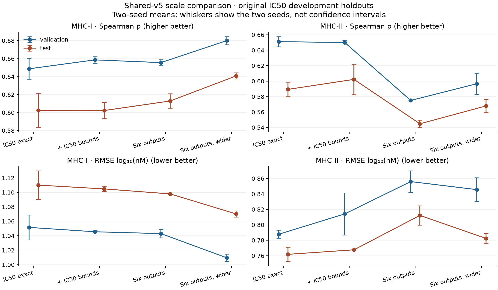
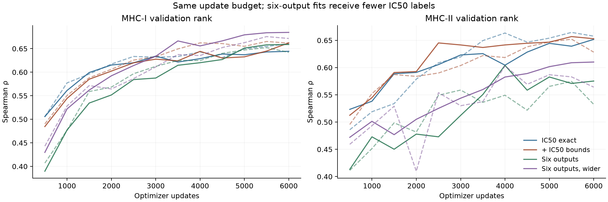

# Shared architecture: larger data, distinct outputs and capacity

**Status: complete. Eight fits, independent numerical verification and fresh-H100 serving replay passed.**
Agent/model: Codex / GPT-6. Date2026-10-27. Follows the validation-selected
shared-v5 interaction architecture in `2026-10-27_2100_codex_transfer-improvements`.
Detailed implementation plan: `../agents/codex/plans/2026-10-27_scale-shared-model.md`.
Source audit: `../2026-10-27_2235_codex_shared-support-audit/README.md`.

## Frozen comparison before fitting

Eight fits: four conditions, seeds42 and43. Each starts from scratch and uses the
same observation-manifest trainer, shared encoder, residue interaction, ordered
full peptide context, candidate aggregation and endpoint-specific physical readout.
No pretraining, synthetic labels, identity losses, class-specific heads, learning
rate schedule, AMP, TF32, clipping or changed target caps. Mean standardized
one-sided squared loss per observed assay row; each literal endpoint has its own
scale fitted on exact training outcomes only. AdamW3e-4, decay1e-4, batch64,
dropout0.1;6000 updates, validation every500 updates and at final budget,
checkpoint every100. Early stopping disabled within that budget. Natural sampling
without replacement per data epoch; no endpoint or class balancing. Exposures are
reported separately, because matched updates do not give matched IC50 exposure.

| Condition | Training observations | Shared capacity |
| --- | --- | --- |
| `ic50-exact` | Frozen original exact IC50 training rows |128/2layers/4heads/512FF|
| `ic50-bounds` | Same IC50 rows plus original admitted training bounds |128/2/4/512|
| `multi-assay` | All qualified IC50, directKD, EC50, KD(~IC50), KD(~EC50), half-life |128/2/4/512|
| `multi-assay-wide` | Identical six-output data |192/3/6/768|

The first contrast isolates original bounds. The second adds distinctly labeled
measured endpoints (including proxies); it does not isolate number of rows from
new supervision. The third isolates model capacity. No label-shuffle mechanism
claim is made. All models use peptide and both verified groove sequences; the
larger source adds peptide/groove diversity, not invented cellular/TCR context.
The seven-endpoint admission retains10off-rate training rows, but no off-rate
validation/test rows exist. Off-rate is excluded from these fits and is not a
validated output. EC50 class-II evaluation coverage must be reported explicitly.

## Data and leakage contract

Pinned Hitlistv4 binding/other-assays exports, original purified-MHC quantitative
text, qualifiers and units, canonical unmodified peptides, complete source-named
human MHC partners from the pinned mhcseqs catalog. No guessed DRA or partner.
The original27,364-row IC50 cohort files remain byte-identical. Across endpoints,
peptide and original-assay connected components inherit frozen historical/IC50
splits; conflicting components are deferred. Original measured-outcome IDs have
one vote; independent replicate disagreements remain. Manifest/source hashes and
exact counts are frozen in `reproduce/source-pins.json`; independent source-byte,
unit/target, catalog and cross-endpoint leakage verification precedes launch.
These are development holdouts, with study and sequence-family overlap possible;
new endpoint readouts do not create an independent prospective population.

## Selection, reporting and promotion

Trainer checkpoint selection: lowest validation exact IC50 RMSE (the existing
common selection rule), at identical update opportunities. Final predictive tests
are evaluated once on that selected checkpoint. The local controller exposes only
validation during fitting; condition selection is sealed before opening test dumps.
Primary promotion comparison uses **original IC50 validation IDs**, exact values,
separately by class. New-condition two-seed mean macro class Spearman must improve
by at least0.01 over `ic50-exact`, with neither class losing more than0.005Spearman
or worsening RMSE by more than2%. At least one seed must improve each class and
both seeds must improve macro Spearman. Select the qualifying condition with the
highest macro Spearman; ties within0.005 favor smaller parameter count, then fewer
outputs. If none qualifies, retain the existing IC50 recipe and publish the added
outputs as experimental with their measured limits. No observed test result can
change that decision. Also report all six per-endpoint/class heldout metrics,
train-mean baselines, bounds, calibration, per-groove strata, input/weight evidence
and exact endpoint/class label exposures. Sparse or missing strata are not qualified.

GPU: requested **H100!**, at most2concurrent workers;4CPU,32GiBhost RAM,4h timeout
per worker. Record actual device and memory from PyTorch and nvidia-smi. This budget
extends prior2000-update fits; hardware/runtime contracts remain explicitly separate.

## Reproduction and closure

`code/prepare.py` freezes data manifests, exact runtime files and checksums;
`code/launch.py` runs the frozen bundle on Modal and collects complete archives.
`reproduce/launch.json` and `launch.sh` record the invocation and environment.
Large data and raw checkpoints live in repo-level `data/` and `artifacts/`;
canonical per-example heldout dumps, summary tables and decisions belong in
`results/`. Add exact runtime, validation/test metrics, support limits and final
decision here and in `../experiment_log.md` before declaring this family complete.

Prelaunch software check: admit every condition with the frozen common runtime,
then execute one CPU update on at most two TRAIN observations per endpoint/class
stratum of the wider model. Preserve its IDs, loss, gradients and checkpoint.
This checks mixed-output execution and is not a predictive fit or test evaluation.
The pinned original IC50 preparer numbers source rows from1; the new scanner
numbers them from0. Independent verification explicitly accounts for both, checks
raw-record fingerprints and does not rewrite the frozen original observations.

## Expanded data and input support

The predictive six-output cohort contains168,200observations:134,561training,
17,503validation and16,136test. Training includes24,792distinct peptides and146
verified groove pairs (147across all partitions). The separately admitted ten
off-rate rows are excluded. The original IC50 controls use21,636exact training
rows, with2,925original validation and2,803original test rows. The bounds arm
uses23,512training rows. Primary comparisons always use original IC50 heldout IDs.

All targets remain separately named. IC50, KD, EC50, KD(~IC50) and KD(~EC50)
use log10(nM); half-life uses log10(minutes). For each endpoint, exact training
outcomes fit its mean and population SD. Each observed row contributes squared
standardized residual; upper/lower bounds contribute only on the violating side.
All endpoint weights are1before averaging over the sampled rows. There are no
cross-assay equality constraints, synthetic labels, pseudo-negatives or pretraining.
For concentration outputs, the500nM table is an endpoint-specific threshold
classification; an EC50/proxy threshold is not a calibrated binding probability.

Counts below are **all / exact** observations.

| Output | Train I | Train II | Validation I | Validation II | Test I | Test II |
|---|---:|---:|---:|---:|---:|---:|
| ic50 | 15,246 / 14,375 | 8,266 / 7,261 | 2,060 / 1,968 | 886 / 758 | 1,856 / 1,758 | 969 / 842 |
| kd | 14,759 / 4,097 | 422 / 350 | 1,898 / 567 | 36 / 32 | 1,606 / 561 | 96 / 82 |
| ec50 | 288 / 288 | 19 / 19 | 31 / 31 | 3 / 3 | 47 / 47 | 0 / 0 |
| kd_via_ic50 | 41,940 / 39,835 | 1,104 / 886 | 5,459 / 5,182 | 207 / 183 | 5,069 / 4,808 | 168 / 123 |
| kd_via_ec50 | 30,628 / 9,113 | 14,218 / 11,307 | 4,020 / 1,175 | 1,935 / 1,529 | 3,819 / 1,154 | 1,570 / 1,231 |
| half_life | 7,659 / 7,650 | 12 / 12 | 968 / 968 | 0 / 0 | 934 / 934 | 2 / 2 |

Training class proportions shift from66.4%I/33.6%II in the exact IC50 control
to82.1%I/17.9%II in the six-output data. About98.6%of class-I training rows are
9–10mers;89.4%of class-II rows are15mers. Long/unusual ligands have sparse support.
All observed grooves are classical human HLA-A/B/C or DR/DP/DQ; no nonclassical
or nonhuman transfer is tested. Peptide and verified groove sequences gain diversity;
cellular machinery, source-protein context, TCR and MS inputs receive no new data.

Training-only exact pMHC overlap is highly asymmetric. IC50 and KD(~IC50) share
6,676class-I contexts (correlation of per-context mean measurements0.963), but
only two class-II contexts. IC50/directKD overlap is69I/zeroII. This is a possible
source of unequal auxiliary benefit, not a causal finding: assay conditions are
not matched, and separate original assay IDs are not guaranteed independent studies.
The two labeled assays remain distinct. `training-output-overlap-by-class.csv`
and the source-disposition ledger preserve the full accounting.

No new source-only/zero-shot class-transfer experiment is included in this family.
The earlier single-class comparisons remain the relevant evidence for that question.

## Results and integration decision

The validation-only decision is sealed in `results/validation-decision.json`.
**Retain the 128-wide shared-v5 architecture with exact IC50 supervision and
natural sampling; extend its development recipe to the tested 6,000-update budget.**
No added-data condition passed all prospective gates. Six-output small/wide
manifests remain explicitly experimental and run through the identical common
trainer. No test result changed this decision. The pre-disclosure integration
contract is preserved in `reproduce/closure-launch.json`.

Two-seed means below are individual-model metrics, not an ensemble. All comparisons
use the original IC50 holdout IDs: validation 1,968 I / 758 II exact values, test
1,758 I / 842 II. RMSE is log10(nM).

| Condition | I validation ρ / RMSE | I test ρ / RMSE | II validation ρ / RMSE | II test ρ / RMSE |
|---|---:|---:|---:|---:|
| IC50 exact | .6487 / 1.0516 | .6025 / 1.1100 | .6511 / .7878 | .5893 / .7618 |
| IC50 plus bounds | .6586 / 1.0455 | .6022 / 1.1048 | .6500 / .8142 | .6023 / .7677 |
| Six outputs | .6555 / 1.0430 | .6129 / 1.0978 | .5750 / .8560 | .5448 / .8122 |
| Six outputs, wider | .6800 / 1.0094 | .6407 / 1.0702 | .5966 / .8456 | .5679 / .7824 |

The wider six-output model improves class-I validation rank by .0314 and RMSE by
4.0%, but loses .0545 class-II rank and worsens its RMSE by 7.3%. The small model
loses .0761 class-II rank. Bounds improve some censoring outcomes but fail the
macro-rank, seed consistency and class-II RMSE gates. This is evidence against
blindly replacing the IC50 recipe with natural sampling from all admitted assays.

The wider model's class-I test rank gain is .0382; its paired peptide-bootstrap
95% interval is [.0125, .0638]. Class-II delta is −.0215, interval [−.0635, .0168].
The small model's class-II delta is −.0445, interval [−.0882, −.0037]. These 1,000-draw
intervals condition on the existing development population and two trained seeds;
they do not establish study independence or uncertainty across future training seeds.
Class-II exact test rows represent only 133 distinct peptide clusters.

Compared with the earlier 2,000-update v5 recipe, exact-only test rank changes
from .5248/.5039 to .6025/.5893 and RMSE from 1.1899/.8059 to 1.1100/.7618 for I/II.
This is a new practical development reference, not an isolated budget ablation:
the validation cadence also changed from data epochs to every 500 updates.
No new external biological qualification or zero-shot result is implied.

[All six outputs, exact sample counts, mean baselines and runtime tables](results/report-tables.md)
and `results/all-output-means.csv` retain the broader outcome. The wider model's
class-I test half-life rank is .6995 (RMSE .8256 log10 minutes, mean baseline 1.1847)
and KD(~IC50) rank .6999 (RMSE 1.0345, baseline 1.4106). Direct KD illustrates a
different failure: class-I test rank .5586 but RMSE 1.3477 is **worse** than the
constant training-mean baseline 1.2753. Positive rank does not establish calibrated
affinity. Class-I EC50 has only 47 exact test values; its wider-model rank .1853
falls well below validation .4654. Class-II KD(~IC50) drops from validation .5912
to test .2772. These endpoint heads were selected by IC50, not by their own metrics.

## Failure modes and weight/input support

1. **Unequal supervision, rather than untrained class-specific branches.** The
   added data is 82.1% class I. At 6,000 updates, the small six-output seed42 fit
   sees 43,487 I and 23,546 II IC50 labels, versus 254,456/128,524 for the control.
   Its class-II training rank is only .5627, versus .6883 for the control; wider
   training rank is .5805. Reduced target exposure, auxiliary competition and
   asymmetric cross-assay overlap are plausible explanations, not isolated causes.
   There is no separate class-II encoder to leave untrained. Full-budget label
   exposures are distinguished from selected-checkpoint training metrics.
2. **Calibration and censoring remain weak.** On the original test bounds, exact
   controls satisfy only 6.9% I / 17.2% II on average. Adding training bounds raises
   this to 27.0% / 33.6%, still low and accompanied by class-II validation RMSE loss.
   The control overpredicts the 61 sub-nM class-I exact measurements by 1.82/1.88
   log units and underpredicts 84 exact measurements in the 100,000–1,000,000 nM
   bin by 1.19/.93 log units (seeds42/43). No post-test calibration was fitted.
3. **Pooled rank overstates some within-groove performance.** Among groove pairs
   with at least 20 exact test values, control macro rank is .430/.442 for I
   (12 groups) and .568/.566 for II (10 groups). The wider model gives .482/.529 I
   and .562/.524 II. Groups use actual paired groove sequences, retaining allele
   aliases, not raw label spelling. These are not unseen-groove benchmarks: all
   IC50 test grooves occur in expanded training, as do almost all source studies.
   In wider seed42, class-II rank is .619 on 713 exact test rows sharing a training
   9mer and .326 on 129 without one; this is a descriptive, composition-confounded
   subgroup difference, not a causal core-sharing test.
4. **Registers are trained but diffuse and unvalidated.** Control class-II test
   normalized entropy is .979/.983 (uniform = 1); median maximum weight .201/.194.
   No IC50 register has weight above .5. Top-start agreement is 51.4% between seeds
   versus a 14.2% uniform random reference. Wider models are similarly diffuse
   (entropy .986/.986). No measured core labels exist here; statistical pooling
   weights are not physical occupancy or validated binding-core locations.
5. **Element coverage is complete except deliberate padding, not proof of
   identifiable biology.** At selected checkpoints all 515,329/515,974
   non-padding coordinates in the small one-/six-output models and 1,599,750 in the wider model
   have cumulative same-coordinate gradient-and-update evidence. The only untouched
   coordinates are 128 or 192 fixed padding values. Of the updated coordinates,
   384/768 attention key biases are structurally redundant under softmax. Constant
   human-species columns are confounded with the fusion intercept. Historical
   checkpoints without element masks retain unknown history. Adding five outputs
   at fixed width adds only 645 parameters; the encoder, interaction and pooling
   remain common.
6. **Data support is highly uneven.** Class-II EC50 has 19 training / 3 validation /
   zero test exact observations; half-life has 12 / zero / 2. A rank of 1 on two
   values is not qualification. Direct KD II has only 32 validation exact values.
   Ten off-rate rows have no holdout and were excluded. Nonhuman/nonclassical MHC,
   unusual lengths, source proteins, cellular machinery, TCR and MS do not gain
   validated support from these fits. Absent modules are not allocated or claimed
   trained. Most training I ligands are 9–10mers and most II ligands are 15mers.

`failure-strata.csv`, `groove-metrics-min20.csv`, `register-diagnostics.json`,
`output-class-support.csv`, `training-metrics-independent.csv` and
`coverage-runtime.csv` preserve these checks. The finite subgroup audit is
exploratory; no subgroup led to a refit or changed promotion decision.

## Exact runtime, verification and artifact map

Predictive runtime is frozen at **0c4c984b2628fecf54ef29e756fdfc0a74963dc4**;
launch Git was dirty because of the new experiment bundle. Exact launcher and
runtime hashes, source pins and files are retained, so dirty status is not relied
on for reproduction. Post-freeze software refinements are tracked separately;
none changed these eight fits. Python3.12.1, Torch2.14.1+cu130, NumPy2.5.4,
mhcseqs2.6.13, mhcgnomes3.64.6, PyYAML6.0.3, tqdm4.70.1, psutil7.2.2.
All actual devices: NVIDIA H10080GBHBM3, 81,559MiB reported by nvidia-smi,
85,009,367,040 bytes reported by Torch, driver610.57.04. Threads4/interop1,
max2workers. No AMP, TF32 or compile. Local analysis uses Python3.12.6,
single BLAS/Torch thread and `MPLCONFIGDIR=/private/tmp/presto-scale-mpl`.

Worker wall time ranges 1,287.8–2,279.8 seconds, excluding queue/build/archive/
download. Sampled RSS is 4.96–6.06GiB; CUDA allocated peak .67–1.42GiB. RSS is
sampled, not a continuous OS high-water measurement. All eight completed 6,000
updates; selected updates are 5,000–6,000, listed in the runtime table. Model
parameter counts are 515,457 / 516,102 / 1,599,942.

- Training app: https://modal.com/apps/iskandr/main/ap-CJwlq0nqqer3zUmhh4ihGh
- One original invocation: `PRESTO_MODAL_GPU='H100!' /Users/iskander/code/shared-virtual-env/bin/modal run --detach experiments/2026-10-27_2255_codex_shared-multi-assay-scale/code/launch.py` from the clean shared-training checkout.
- Frozen commands/env: `reproduce/launch.sh`, `launch.json`, `closure-launch.json`;
  source: `reproduce/source/`; prospective protocol: `reproduce/protocol.md`.
- Prepared data: repo `data/modular_cohorts/2026-10-27-purified-multi-assay` and
  checksummed copies under `artifacts/2026-10-27_2255_codex_shared-multi-assay-scale/upload/inputs/data`.
- Raw archives: `artifacts/2026-10-27_2255_codex_shared-multi-assay-scale/downloads/<condition>.tar.gz`;
  selected checkpoints: `artifacts/2026-10-27_2255_codex_shared-multi-assay-scale/runs/<condition>/raw/selected.pt`.
  Every `results/<condition>/report.json` records hashes and exact local/Modal paths.
- Modal volume `presto-checkpoints`: family directory with per-condition archives
  and selected checkpoints. Canonical validation/test prediction dumps and original
  observations: `results/<condition>/{validation,test}-predictions.jsonl.gz`.
  Mean-baseline dumps are also retained. Full training dumps remain checksummed in
  raw archives; training-metric verification receipts record their exact hashes.
- Independent SciPy/sklearn checks verify all eight source-ID joins, input/target/
  unit/qualifier/scaler mappings, squared/censored losses, regression metrics,
  applicable 500nM classification, baselines and element masks. All 112 heldout
  endpoint/class table rows pass. All eight full training dumps also pass.
- Mean-baseline dump diagnostics inherited from neural dump copies are ignored;
  only the independently checked constant predictions and losses define that
  baseline. Original files are preserved verbatim.
- Numerical-analysis amendments before disclosure fixed mask-list interpretation,
  baseline row-order checks and grouping by actual groove pairs. Their snapshots
  and rationale are recorded; no predictive result or decision gate changed.
- The initial serving replay stopped before inference because the training-only
  runtime omitted the public inference package. The recovery exported all 210
  packaged files from the identical pinned commit, verified all 207 frozen runtime
  files byte-for-byte, and imported the public predictor locally first. Original
  failed logs/source remain intact; `reproduce/replay-recovery.json` and
  `serving-runtime.json` record the recovery. All **512 saved TRAIN probes across
  eight checkpoints replay exactly**, both through evaluation and guarded public
  prediction on fresh H100 processes. No fitting or heldout inference occurred.
  Replay app: https://modal.com/apps/iskandr/main/ap-tGRs3rOq5ua5vkbdzsc1vF
- Common software: 2,767 unique tests passed across full/targeted checks, four skips;
  pinned lint/format, strict docs and isolated installed-wheel execution pass.
  Three initial test failures were missing tracked historical files in sparse
  checkout; restored files passed. Hosted CI passed on bad9f4c1 (run40610700844).

Next bounded hypotheses are matched IC50 exposure and class/endpoint-aware
sampling within this same trainer, followed by source-qualified paired assay/core
evidence. Do not tune against these inspected tests. This family does not satisfy
PR131's remaining biological, precursor/MS or authorized TCR milestones.
