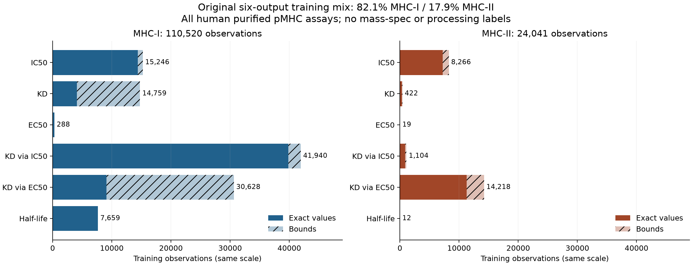

# Why do six assay outputs help MHC-I more than MHC-II?

Status: twelve fixed fits submitted; two H100 workers active. Results pending.
Agent/model: Codex / GPT-6. Date: 2026-10-28 UTC.

Detailed pre-implementation contract:
[plan](../agents/codex/plans/2026-10-28_assay-transfer-mechanisms.md).
Extends [the closed scale family](../2026-10-27_2255_codex_shared-multi-assay-scale/README.md).

Inventory the earlier data and separate capacity, class exposure, IC50 exposure
and auxiliary label information through the common trainer. A new component split
uses earlier TRAIN rows only; old heldouts and fitted weights are excluded.
This remains a development experiment, not external biological qualification.

Freeze source/data/manifests/invocation under `reproduce/`; keep live validation,
per-example heldout dumps, independent metrics, plots, replay and support evidence
under `results/`. Large inputs/checkpoints live in repo-level `data/`/`artifacts/`.

## What the earlier 134,561 training observations contain

All are human purified pMHC measurements. The six outputs represent five
concentration-based binding assay families and half-life stability, not six
interchangeable affinity labels. There are no mass-spectrometry, antigen-processing,
cell-context or TCR targets, and no nonhuman/nonclassical MHCs in this cohort.

| Output | MHC-I | MHC-II |
|---|---:|---:|
| IC50 |15,246|8,266|
| KD |14,759|422|
| EC50 |288|19|
| KD inferred via IC50 |41,940|1,104|
| KD inferred via EC50 |30,628|14,218|
| Half-life |7,659|12|
| **Total** |**110,520 (82.1%)**|**24,041 (17.9%)**|

These are observations, covering 24,792 unique peptide sequences, 117,834 unique
peptide/groove contexts and 146 groove-sequence pairs (98 class I, 48 class II).
95,193 are exact values; 39,368 (29.3%) are bounds. Natural row sampling did not
balance alleles, studies or classes. HLA-A/B/C contribute 73,984/34,908/1,628 rows;
DQ/DRB1/DP/DRB3/DRB4/DRB5 contribute 10,815/5,687/4,284/1,981/659/615.
A*02:01 alone contributes 13,723 class-I rows (12.4%). The largest class-II groove,
DQA1*05:01/DQB1*02:01, contributes 1,142 (4.8%). Sequence-identical catalog names
are grouped by grooves rather than counted as distinct biological inputs.
86,240 class-I rows are 9-mers (78.0%); 21,483 class-II rows are 15-mers (89.4%).
Full allele, study/source, length and qualifier inventories are under `results/`.

The class-level totals conceal locus/endpoint mismatches. Class-II IC50 contains
3,594 DP, 4,554 DQ and only 118 DR observations: 98.6% DP/DQ. Its dominant
auxiliary KD-via-EC50 endpoint instead contains 5,447 DQ and 8,771 DR observations
(61.7% DR), with no DP. Class-I IC50 contains 13,120 HLA-A and 2,126 HLA-B rows,
with no HLA-C. Thus aggregate IC50 scores do not qualify all loci within a class.
See `results/original-training-gene-endpoint.csv` for the complete cross-tabulation.

There was no arbitrary sample cap. Of 840,805 scanned source rows, 168,210 were
admitted; ten off-rate rows lacked predictive split support and were excluded.
The predictive cohort is 168,200 rows: 134,561 train, 17,503 validation and 16,136
test. Main exclusions: 586,064 outside the supported purified quantitative assay
definitions; 55,371 missing an explicit MHC partner; 16,957 not explicitly human;
9,696 not explicitly purified; 1,832 unresolved catalog names; 1,519 modified or
unspecified peptidoforms; 870 invalid measurements; 247 unsupported peptide/class;
39 non-peptide ligands. Missing DRA partners were not guessed.

The earlier exact-IC50 control had 21,636 training observations, 66.4% class I.
At the same 6,000-update budget, seed42's exact-IC50 control presented
254,456/128,524 I/II IC50 labels to the optimizer, versus 43,487/23,546 in the
natural six-output arm. The earlier wider model also lacked a wider IC50-only
control. Thus the earlier result cannot isolate useful auxiliary transfer from
capacity, target exposure and class composition.

## Fixed prospective comparison

Only the prior TRAIN rows enter this family. New connected components join shared
peptides, measurement identities and group IDs/aliases; fixed salted hashing gives
107,132 train / 13,425 validation / 14,004 test observations. All 33,639 old heldout
rows are excluded, and no old fitted weights are reused. These are new development
partitions of previously trained-on data, not untouched external biological evidence.
Study and sequence-homology overlap may remain. The independent data audit passes.

| Variant | Width/layers/heads/FF | Sampling | Batch |
|---|---|---|---:|
| small-ic50 |128/2/4/512|IC50 exact+bounds, natural|64|
| wide-ic50 |192/3/6/768|same IC50, natural|64|
| wide-six-natural |192/3/6/768|six outputs, natural|64|
| wide-six-class-balanced |192/3/6/768|six outputs, equal class frequency|64|
| wide-six-primary-matched |192/3/6/768|50% IC50; other 50% natural auxiliary proportions|128|
| wide-six-primary-shuffled |192/3/6/768|same inputs/sampler as matched; permuted auxiliary TRAIN values|128|

Two seeds (42/43), 6,000 updates each, no pretraining, dropout 0.1, AdamW learning rate 3e-4,
weight decay1e-4, no schedule/AMP/TF32/compile. All use shared-v5 and the same
`fit_index` path. Output order puts IC50 first; same-width/seed common-core and
IC50-head initialization must match. Concentration targets use log10(nM), half-life
uses log10(minutes), with exact-TRAIN-only means/scales. Loss is mean standardized
squared error, one-sided for bounds; all endpoint/row loss weights are 1.
Validation every 500 updates; select pooled exact-IC50 validation RMSE; no early
stopping. Each selected checkpoint's test set is evaluated once by the trainer.
Human inspection/analysis of tests waits for the sealed validation-only decision.

The paired synthetic negative control permutes 88,155 auxiliary TRAIN rows within
endpoint/class/groove/qualifier, seed 73028; 59,943 values change. Singleton/constant
strata remain unchanged. Original values/donor identities are preserved and
independently verified. Heldout labels remain measured. The synthetic arm cannot
be promoted. Primary matching preserves expected IC50 labels per update, not
identical gradients: total batch, compute and loss normalization also differ.
Actual endpoint/class optimizer exposures are recorded and checked against a
frozen simulation of the common sampler.

Promotion uses the prespecified wide-ic50 comparator: macro class rho gain ≥0.01,
no class rho loss >0.005, no class RMSE deterioration >2%, positive macro gain in
both seeds, and some seed improvement in each class. Ties within 0.005 favor lower
compute. Only real six-output arms are eligible. A winner here is specific to this
development cohort and does not automatically replace the prior full-cohort recipe.

## Reproduction and current verification

Runtime package: commit `89d3360a307b5485cdc3e3f37abcac1dfa9cf979`, frozen complete
package including inference in `reproduce/source/runtimes/shared/presto`.
Launcher commit `fe9ca8b82489b5afc222e3f2237460ef7bd7af63`; launch receipt records
dirty=true because it creates its source snapshots before recording git status.
Package and launcher/data hashes are individually pinned; no unfrozen model code
is used. Exact command/env: `reproduce/launch.sh` and `reproduce/launch.json`.
Transport gzip is 46,652,237 bytes, losslessly verified against 1,197,269,176 expanded
bytes. No observations were removed to reduce upload size.

Requested GPU `H100!`, at most two concurrent workers, 4 CPUs/32 GiB host each.
Observed NVIDIA H100 80GB HBM3, 81,559 MiB, driver 610.57.04. Pinned environment:
Python 3.12, Torch 2.14.1, NumPy 2.5.4, PyYAML 6.0.3, mhcgnomes 3.64.6, mhcseqs 2.6.13,
tqdm 4.70.1, psutil 7.2.2. Local source admission/preflight covers all three distinct
source sets; weighted/unweighted resume and sampler tests pass. Full local suite: 2,778 passed / 4 skipped; analysis fixtures: 2 passed. Lint/format, strict
docs, wheel/sdist build, twine and installed-wheel checks pass. Per-checkpoint
scientific verification remains pending.

- [Modal app](https://modal.com/apps/iskandr/main/ap-1AHTEVt9VZBzGnh9yZsvRh)
- [Local live comparison](http://127.0.0.1:54501/)
- Durable call IDs/controller: `reproduce/call-ids.json`, `reproduce/controller.json`.
- Inputs: `data/modular_cohorts/2026-10-28-assay-transfer-mechanisms` and
  `artifacts/2026-10-28_0250_codex_assay-transfer-mechanisms/upload`.
- Full raw artifacts/checkpoints: `artifacts/2026-10-28_0250_codex_assay-transfer-mechanisms/runs`;
  Modal volume `presto-checkpoints` under this family ID.
- Canonical prediction dumps/summaries: `results/<condition>/`; full TRAIN dumps
  remain in the artifact directories, while heldout dumps are versioned here.

Final metrics, mechanistic interpretation, paired peptide-bootstrap intervals,
failure strata, fresh-H100 serving replay and registry closure remain pending.

## Training-only assay overlap

On the new measured TRAIN partition, exact IC50 and KD-via-IC50 labels overlap
on 5,345 class-I peptide/groove contexts, with Spearman 0.9568 between mean
log targets; class II has only two overlapping contexts. IC50/half-life overlap
is 1,940 contexts for I and eight for II. No original measurement IDs overlap
between these endpoint pairs. Assay conditions/studies are not matched, so this
quantifies label alignment and coverage, not equivalence or causal transfer.
See `results/training-assay-overlap.json` and `results/permutation-coverage.csv`.
All arms train both MHC classes: this family tests auxiliary-label benefit and
interference, not a source-class-only zero-shot transfer claim.

## Live-report recovery

At approximately 04:26 UTC, remote container inspection confirmed four fits were
complete and both exposure controls were running, while the local dashboard still
showed two collected fits and stale export states. Downloading a ~226 MB archive
blocked the original controller's status polling. A separate read-only poller now
reads only this family's twelve existing Modal Dict keys every ten seconds and
writes `results/live-workers.json`; the original controller retains exclusive
ownership of archive collection. The dashboard merges current worker state,
shows remote completion separately from downloaded archives and displays poll age.
Its owned loopback server was restarted; no fit, queued call, input, optimizer,
checkpoint or selection rule changed. HTTP verification confirms current states
and continued test-score concealment. Invocation/source hash:
`reproduce/worker-poller.json`; recovery receipt: `results/live-progress-recovery.json`.

The original Volume API download retained missing byte ranges despite reaching
the expected logical file size. A separate ordered-read probe timed out at 64 MiB;
both incomplete files and their failure receipts are preserved. A CPU-only Modal
function then streamed the already committed archive through mounted-filesystem
reads in 256 KiB chunks: 225,755,015 bytes in 20.49 seconds, with the original full
SHA256 verified remotely and locally. One CPU worker, no GPU, now caches each
completed archive separately (`reproduce/readback-watch.json`). No fit is retried.
The original controller stays alive until all twelve original function calls
return. Only then may the guarded `analysis/collection_handoff.py` transfer
collection ownership, preserving the original controller receipt and failed
partials. Canonical extraction and report generation reuse the frozen original
collector with verified local-file transport; predictions, metrics and tolerances
are unchanged. Final collection/verification is still pending.

Archive headers revealed ~3.20 GB expanded per six-output fit. Collection therefore
keeps all original checksum-verified archives, checkpoints and gzip predictions,
but removes six redundant raw JSON/JSONL expansions per run only after each file
matches its archive member byte-for-byte. Per-file recovery coordinates and hashes
are retained before removal. The collector checks extraction space plus a 2 GiB
reserve, and every removed file remains exactly recoverable from the original
local and remote archives. A software check confirms corrupt expansions fail
before any deletion; no heldout metrics are parsed during this storage check.

A posthoc descriptive audit added during execution will compare the fixed pooled
IC50-RMSE checkpoint choice with each class's best validation-history point and
the minimum unweighted mean class RMSE. This diagnoses selection trade-offs only;
alternate checkpoints are not selected, promoted or evaluated on test.
