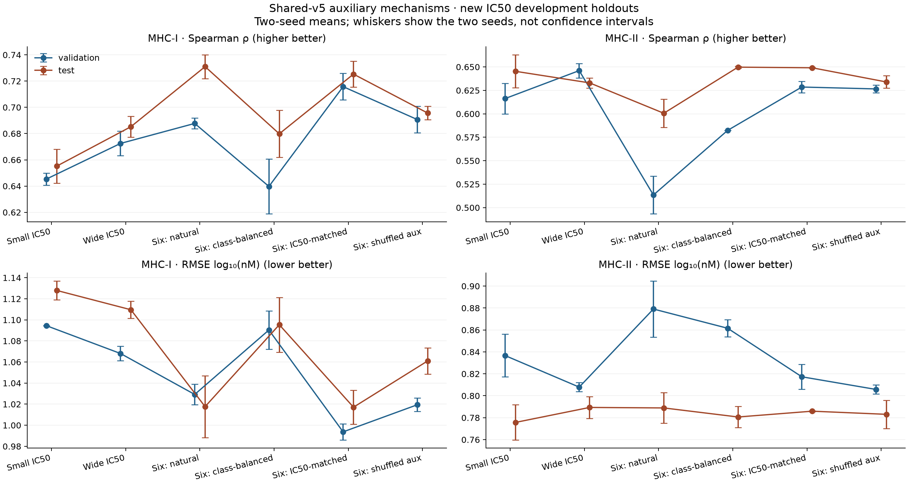
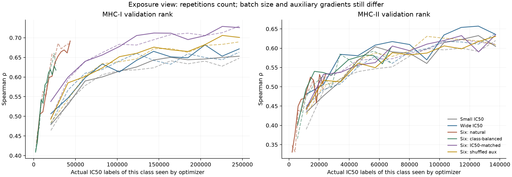

# Why do six assay outputs help MHC-I more than MHC-II?

Status: complete. All twelve fixed fits, independent numerical checks and fresh-H100
evaluation/public-serving replays passed. No six-output recipe passed promotion.
Agent/model: Codex / GPT-6. Date: 2026-10-28 UTC.

Detailed pre-implementation contract:
[plan](../agents/codex/plans/2026-10-28_assay-transfer-mechanisms.md).
Extends [the closed scale family](../2026-10-27_2255_codex_shared-multi-assay-scale/README.md).

Inventory the earlier data and separate capacity, class exposure, IC50 exposure
and auxiliary label information through the common trainer. A new component split
uses earlier TRAIN rows only; old heldouts and fitted weights are excluded.
This remains a development experiment, not external biological qualification.

Freeze source/data/manifests/invocation under `reproduce/`; keep live validation,
per-example heldout dumps, independent metrics, plots, replay and support evidence
under `results/`. Large inputs/checkpoints live in repo-level `data/`/`artifacts/`.

## Completed controlled comparison

All twelve fixed fits, independent heldout/full-training checks and fresh-H100
evaluation/public-serving replays pass. The validation-only decision retains
**wide-ic50 as this cohort's prespecified reference**: no real six-output arm
passes every class-protection gate. The prior full-cohort IC50 recipe remains
unchanged. These are two-seed means, not ensembles; RMSE is log10(nM).
Exact IC50 validation counts are I=1,433 / II=623; test counts I=1,476 / II=683.

| Condition | I validation ρ / RMSE | II validation ρ / RMSE | I test ρ / RMSE | II test ρ / RMSE | Mean worker min |
|---|---:|---:|---:|---:|---:|
| Small IC50-only | 0.6453 / 1.0945 | 0.6163 / 0.8367 | 0.6552 / 1.1279 | 0.6454 / 0.7757 | 22.0 |
| Wide IC50-only | 0.6725 / 1.0681 | 0.6461 / 0.8079 | 0.6853 / 1.1096 | 0.6330 / 0.7894 | 23.1 |
| Six outputs, natural | 0.6877 / 1.0292 | 0.5135 / 0.8791 | 0.7310 / 1.0177 | 0.6006 / 0.7889 | 33.9 |
| Six outputs, class-balanced | 0.6397 / 1.0904 | 0.5824 / 0.8616 | 0.6798 / 1.0954 | 0.6498 / 0.7807 | 36.8 |
| Six outputs, IC50-matched | 0.7158 / 0.9937 | 0.6286 / 0.8173 | 0.7253 / 1.0171 | 0.6491 / 0.7859 | 54.2 |
| Matched, shuffled auxiliary values | 0.6907 / 1.0194 | 0.6266 / 0.8058 | 0.6956 / 1.0611 | 0.6340 / 0.7831 | 51.5 |

Worker time includes setup, fitting and evaluation export, but excludes queue,
image build, parent archive packaging and transport. Total worker time is
7.384 H100-hours; this is not a billing estimate. All runs share the same
model/trainer. Six-output heads add only 965 parameters to the 1,598,977-parameter
wide IC50 model; the small control has 515,457 parameters.

## What the controls establish

- **Capacity is a real confound in the earlier comparison.** Wide versus small
  IC50 improves I Spearman by 0.0272 on validation and 0.0301 on test. II improves
  by 0.0298 on validation but falls by 0.0124 on test; its paired test interval
  includes zero. A general class-II capacity gain is therefore not established.
- **Primary-task dilution explains much of the II deficit.** Matching IC50
  exposure improves II over the natural six-output mix by 0.1151 validation and
  0.0485 test Spearman. Paired peptide-bootstrap 95% intervals are [0.0669, 0.1648]
  and [0.0143, 0.0797]. Mean II training Spearman is 0.7656 for wide IC50, 0.5862
  for natural six-output training, and 0.7289 after matching. The natural arm is
  fitting the primary target poorly, rather than showing only a larger train/test
  gap. Matching counts still changes batch size, compute and mean-loss
  normalization; it does not match the primary gradient contribution exactly.
- **Measured auxiliary values help I beyond the conditional shuffle.** Real
  versus shuffled auxiliary values improve I by 0.0251 validation / 0.0297 test
  Spearman, with intervals [0.0061, 0.0450] / [0.0120, 0.0493]. II differences are
  0.0020 / 0.0151, with intervals [-0.0283, 0.0293] / [-0.0139, 0.0443]. This
  supports peptide-specific quantitative auxiliary benefit for I; additional II
  benefit is uncertain. The shuffle preserves groove/qualifier groups and many
  constant bounds, so it retains informative structure.
- **Class balancing alone is a trade-off.** Relative to the natural mix, it
  recovers II test Spearman by 0.0492 but loses I by 0.0512. It still supplies
  fewer II IC50 labels than the primary-matched and IC50-only arms. Equal class
  totals do not equalize endpoint/locus coverage or primary-task exposure.
- **Selection is not the main explanation here.** A posthoc equal-class-RMSE
  history audit changes three of twelve checkpoint choices: both class-balanced
  runs and small-IC50 seed43. It leaves both natural, wide-IC50 and primary-matched
  choices unchanged. No alternative checkpoint was promoted or evaluated on test.

The primary-matched arm passes the macro-gain, two-seed macro consistency and
RMSE gates, but fails the no-class-rank-drop and each-class-improves gates. Its
II validation Spearman is 0.0175 below the wide control, even though its II test
point estimate is 0.0161 higher. Test inspection does not reverse the sealed
decision. All confidence intervals above are conditional paired peptide-cluster
bootstraps of the mean over two seeds, not uncertainty over new studies or seeds.

## Failure modes, support and scope

The II loss is concentrated in DQ. Validation DQ Spearman is 0.6450 for wide
IC50, 0.4584 for natural six-output and 0.6028 for primary-matched; corresponding
test values are 0.6490, 0.5757 and 0.6243. DP test values are 0.6076, 0.6224 and
0.6679. Only 11 validation / eight test exact IC50 rows are DR, which does not
qualify DR accuracy. The I gains occur in both A and B; no IC50 C outcomes exist.
Full per-groove, locus, length, target-range, censoring and novelty strata are
preserved. Novelty groups are defined relative to each arm's training set, so
some class-I group memberships differ between the IC50-only and six-output arms.

Every non-padding parameter coordinate has same-coordinate gradient and update
evidence. Only fixed padding remains untouched (128 small / 192 wide coordinates).
The 384/768 attention key-bias coordinates are structurally redundant despite
numerical updates; constant human-species input does not identify a species effect.
The II EC50 head has 17 training / zero validation / two test rows; half-life has
11 / one / zero. II direct KD has only 35 exact rows in each heldout split, and
KD-via-IC50 has 54 validation / 58 test. Allocated shared outputs remain unqualified
where supervision is sparse or absent.

II IC50 register weights remain diffuse: normalized test entropy approximately
0.972–0.990, with no maximum register weight above 0.5. These are statistical
weights without measured register truth or physical-occupancy qualification.
All test peptide strings are absent from training, but 1,475/1,476 I and 683/683 II
exact IC50 test rows share a study with training; 573/683 II test rows share at
least one nine-residue substring with training. This is not study- or homology-
independent biological qualification, MS ligand ranking, processing, nonhuman
prediction or source-class-only zero-shot transfer.

## Completed verification and retained evidence

Independent checks cover original targets/units, censor-aware losses, exact-only
training scales, all heldout regression and 500 nM classification metrics,
initialization equality, sampler exposures, checkpoint hashes and coordinate masks.
There are 208 endpoint/class/split metric rows, including loss, Pearson, Spearman,
RMSE, accuracy, balanced accuracy, precision, recall, F1, AUROC and AUPRC where
defined. Half-life retains log10(minutes) and has no concentration threshold.

All 932,964 saved training
predictions were independently checked. All 768 saved
training probes replay exactly through evaluation and the guarded public predictor
on a fresh H100 (maximum error zero for both paths). No new heldout inference,
refitting or tolerance relaxation was used for replay. The training app released
both GPU containers before the separate one-H100 verification run.

Canonical files: `metrics-independent.csv`, `common-ic50-means.csv`,
`all-output-means.csv`, `training-metrics-independent.csv`,
`groove-metrics-min20.csv`, `failure-strata.csv`, `output-class-support.csv`,
`coverage-runtime.csv`, `paired-bootstrap.json`, `register-diagnostics.json`,
`checkpoint-selection-diagnostics.json`, `validation-decision.json`,
`verification-summary.json` and `gpu-training-replay.json`, all under `results/`.
Per-example validation/test dumps are in each condition directory. Full TRAIN
dumps are retained in checksummed raw archives and local ignored gzip copies.
The same common manifest trainer now supports explicit stratum sampling weights;
unweighted behavior and exact resume remain verified. No task-specific training
path or six-output default was introduced. PR131 stays draft pending #130/#132.

## What the earlier 134,561 training observations contain

All are human purified pMHC measurements. The six outputs represent five
concentration-based binding assay families and half-life stability, not six
interchangeable affinity labels. There are no mass-spectrometry, antigen-processing,
cell-context or TCR targets, and no nonhuman/nonclassical MHCs in this cohort.

| Output | MHC-I | MHC-II |
|---|---:|---:|
| IC50 |15,246|8,266|
| KD |14,759|422|
| EC50 |288|19|
| KD inferred via IC50 |41,940|1,104|
| KD inferred via EC50 |30,628|14,218|
| Half-life |7,659|12|
| **Total** |**110,520 (82.1%)**|**24,041 (17.9%)**|

These are observations, covering 24,792 unique peptide sequences, 117,834 unique
peptide/groove contexts and 146 groove-sequence pairs (98 class I, 48 class II).
95,193 are exact values; 39,368 (29.3%) are bounds. Natural row sampling did not
balance alleles, studies or classes. HLA-A/B/C contribute 73,984/34,908/1,628 rows;
DQ/DRB1/DP/DRB3/DRB4/DRB5 contribute 10,815/5,687/4,284/1,981/659/615.
A*02:01 alone contributes 13,723 class-I rows (12.4%). The largest class-II groove,
DQA1*05:01/DQB1*02:01, contributes 1,142 (4.8%). Sequence-identical catalog names
are grouped by grooves rather than counted as distinct biological inputs.
86,240 class-I rows are 9-mers (78.0%); 21,483 class-II rows are 15-mers (89.4%).
Full allele, study/source, length and qualifier inventories are under `results/`.

The class-level totals conceal locus/endpoint mismatches. Class-II IC50 contains
3,594 DP, 4,554 DQ and only 118 DR observations: 98.6% DP/DQ. Its dominant
auxiliary KD-via-EC50 endpoint instead contains 5,447 DQ and 8,771 DR observations
(61.7% DR), with no DP. Class-I IC50 contains 13,120 HLA-A and 2,126 HLA-B rows,
with no HLA-C. Thus aggregate IC50 scores do not qualify all loci within a class.
See `results/original-training-gene-endpoint.csv` for the complete cross-tabulation.

There was no arbitrary sample cap. Of 840,805 scanned source rows, 168,210 were
admitted; ten off-rate rows lacked predictive split support and were excluded.
The predictive cohort is 168,200 rows: 134,561 train, 17,503 validation and 16,136
test. Main exclusions: 586,064 outside the supported purified quantitative assay
definitions; 55,371 missing an explicit MHC partner; 16,957 not explicitly human;
9,696 not explicitly purified; 1,832 unresolved catalog names; 1,519 modified or
unspecified peptidoforms; 870 invalid measurements; 247 unsupported peptide/class;
39 non-peptide ligands. Missing DRA partners were not guessed.

A metadata-only rejoin of the archived missing-partner dispositions finds all
55,371 are reported as class II, including 33,165 IC50 and 20,654 KD-via-IC50
measurements. Lexical restriction labels identify 41,637 DRB1, 3,520 DRB3, 2,770
DRB5, 2,452 DRB4, 1,628 DPB1 and 1,216 DQB1 rows; 2,148 labels remain outside
that lexical grouping. Thus strict complete-partner admission contributes strongly
to the class/locus imbalance. These are deferred source rows, not guaranteed
additional admissible training examples: labels include serotypes and 80 rows
containing "mutant". Partner/construct identity and remaining admission criteria
still require verification. No peptide or quantitative outcome column was read
for this audit, and no row was admitted or used to change the frozen comparison.
See `results/deferred-restrictions.json` and its reproduction receipt. The initial
lexical result is preserved; a word-boundary correction prevents mutation suffixes
such as D57A from being misread as an HLA-A locus, without changing row/class/assay
totals.

The earlier exact-IC50 control had 21,636 training observations, 66.4% class I.
At the same 6,000-update budget, seed42's exact-IC50 control presented
254,456/128,524 I/II IC50 labels to the optimizer, versus 43,487/23,546 in the
natural six-output arm. The earlier wider model also lacked a wider IC50-only
control. Thus the earlier result cannot isolate useful auxiliary transfer from
capacity, target exposure and class composition.

## Fixed prospective comparison

Only the prior TRAIN rows enter this family. New connected components join shared
peptides, measurement identities and group IDs/aliases; fixed salted hashing gives
107,132 train / 13,425 validation / 14,004 test observations. All 33,639 old heldout
rows are excluded, and no old fitted weights are reused. These are new development
partitions of previously trained-on data, not untouched external biological evidence.
Study and sequence-homology overlap may remain. The independent data audit passes.

| Variant | Width/layers/heads/FF | Sampling | Batch |
|---|---|---|---:|
| small-ic50 |128/2/4/512|IC50 exact+bounds, natural|64|
| wide-ic50 |192/3/6/768|same IC50, natural|64|
| wide-six-natural |192/3/6/768|six outputs, natural|64|
| wide-six-class-balanced |192/3/6/768|six outputs, equal class frequency|64|
| wide-six-primary-matched |192/3/6/768|50% IC50; other 50% natural auxiliary proportions|128|
| wide-six-primary-shuffled |192/3/6/768|same inputs/sampler as matched; permuted auxiliary TRAIN values|128|

Two seeds (42/43), 6,000 updates each, no pretraining, dropout 0.1, AdamW learning rate 3e-4,
weight decay1e-4, no schedule/AMP/TF32/compile. All use shared-v5 and the same
`fit_index` path. Output order puts IC50 first; same-width/seed common-core and
IC50-head initialization match and were independently verified. Concentration targets use log10(nM), half-life
uses log10(minutes), with exact-TRAIN-only means/scales. Loss is mean standardized
squared error, one-sided for bounds; all endpoint/row loss weights are 1.
Validation every 500 updates; select pooled exact-IC50 validation RMSE; no early
stopping. Each selected checkpoint's test set is evaluated once by the trainer.
Human inspection/analysis of tests waits for the sealed validation-only decision.

The paired synthetic negative control permutes 88,155 auxiliary TRAIN rows within
endpoint/class/groove/qualifier, seed 73028; 59,943 values change. Singleton/constant
strata remain unchanged. Original values/donor identities are preserved and
independently verified. Heldout labels remain measured. The synthetic arm cannot
be promoted. Primary matching preserves expected IC50 labels per update, not
identical gradients: total batch, compute and loss normalization also differ.
Actual endpoint/class optimizer exposures are recorded and checked against a
frozen simulation of the common sampler.

Promotion uses the prespecified wide-ic50 comparator: macro class rho gain ≥0.01,
no class rho loss >0.005, no class RMSE deterioration >2%, positive macro gain in
both seeds, and some seed improvement in each class. Ties within 0.005 favor lower
compute. Only real six-output arms are eligible. A winner here is specific to this
development cohort and does not automatically replace the prior full-cohort recipe.

## Reproduction and current verification

Runtime package: commit `89d3360a307b5485cdc3e3f37abcac1dfa9cf979`, frozen complete
package including inference in `reproduce/source/runtimes/shared/presto`.
Launcher commit `fe9ca8b82489b5afc222e3f2237460ef7bd7af63`; launch receipt records
dirty=true because it creates its source snapshots before recording git status.
Package and launcher/data hashes are individually pinned; no unfrozen model code
is used. Exact command/env: `reproduce/launch.sh` and `reproduce/launch.json`.
Transport gzip is 46,652,237 bytes, losslessly verified against 1,197,269,176 expanded
bytes. No observations were removed to reduce upload size.

Requested GPU `H100!`, at most two concurrent workers, 4 CPUs/32 GiB host each.
Observed NVIDIA H100 80GB HBM3, 81,559 MiB, driver 610.57.04. Pinned environment:
Python 3.12, Torch 2.14.1, NumPy 2.5.4, PyYAML 6.0.3, mhcgnomes 3.64.6, mhcseqs 2.6.13,
tqdm 4.70.1, psutil 7.2.2. Local source admission/preflight covers all three distinct
source sets; weighted/unweighted resume and sampler tests pass. Full local suite: 2,778 passed / 4 skipped; analysis fixtures: 2 passed. Lint/format, strict
docs, wheel/sdist build, twine and installed-wheel checks pass. All twelve checkpoints passed independent numerical verification and saved-training-probe replay;
external scientific qualification remains separate. Hosted source-head CI40648481129 passed.

- [Modal app](https://modal.com/apps/iskandr/main/ap-1AHTEVt9VZBzGnh9yZsvRh)
- [Local live comparison](http://127.0.0.1:54501/)
- Durable call IDs/controller: `reproduce/call-ids.json`, `reproduce/controller.json`.
- Inputs: `data/modular_cohorts/2026-10-28-assay-transfer-mechanisms` and
  `artifacts/2026-10-28_0250_codex_assay-transfer-mechanisms/upload`.
- Full raw artifacts/checkpoints: `artifacts/2026-10-28_0250_codex_assay-transfer-mechanisms/runs`;
  Modal volume `presto-checkpoints` under this family ID.
- Canonical prediction dumps/summaries: `results/<condition>/`; full TRAIN dumps
  remain in the artifact directories, while heldout dumps are versioned here.

Final metrics, paired peptide-bootstrap intervals, failure strata and serving replay
are complete and recorded above. The canonical registry has been closed.

## Training-only assay overlap

On the new measured TRAIN partition, exact IC50 and KD-via-IC50 labels overlap
on 5,345 class-I peptide/groove contexts, with Spearman 0.9568 between mean
log targets; class II has only two overlapping contexts. IC50/half-life overlap
is 1,940 contexts for I and eight for II. No original measurement IDs overlap
between these endpoint pairs. Assay conditions/studies are not matched, so this
quantifies label alignment and coverage, not equivalence or causal transfer.
See `results/training-assay-overlap.json` and `results/permutation-coverage.csv`.
All arms train both MHC classes: this family tests auxiliary-label benefit and
interference, not a source-class-only zero-shot transfer claim.

## Live-report recovery

At approximately 04:26 UTC, remote container inspection confirmed four fits were
complete and both exposure controls were running, while the local dashboard still
showed two collected fits and stale export states. Downloading a ~226 MB archive
blocked the original controller's status polling. A separate read-only poller was added to
read only this family's twelve existing Modal Dict keys every ten seconds and
writes `results/live-workers.json`; the original controller initially retained exclusive
ownership of archive collection. The dashboard merges current worker state,
shows remote completion separately from downloaded archives and displays poll age.
Its owned loopback server was restarted; no fit, queued call, input, optimizer,
checkpoint or selection rule changed. HTTP verification confirms current states
and continued test-score concealment. Invocation/source hash:
`reproduce/worker-poller.json`; recovery receipt: `results/live-progress-recovery.json`.

The original Volume API download retained missing byte ranges despite reaching
the expected logical file size. A separate ordered-read probe timed out at 64 MiB;
both incomplete files and their failure receipts are preserved. A CPU-only Modal
function then streamed the already committed archive through mounted-filesystem
reads in 256 KiB chunks: 225,755,015 bytes in 20.49 seconds, with the original full
SHA256 verified remotely and locally. One CPU worker, no GPU, was used to cache each
completed archive separately (`reproduce/readback-watch.json`). No fit is retried.
The original local controller later exited on a DNS resolution error; the detached
training app continued every original fit. After all twelve original function calls
returned and every archive passed its original SHA256 check, the guarded
`analysis/collection_handoff.py` transferred collection ownership. The original
controller receipt, error log and failed partials are preserved. Canonical
extraction/report generation reused the frozen original collector with verified
local-file transport; predictions, metrics and tolerances were unchanged.
Final collection and independent verification are complete for all twelve fits.

Archive headers revealed ~3.20 GB expanded per six-output fit. Collection therefore
keeps all original checksum-verified archives, checkpoints and gzip predictions,
but removes six redundant raw JSON/JSONL expansions per run only after each file
matches its archive member byte-for-byte. Per-file recovery coordinates and hashes
are retained before removal. The collector checks extraction space plus a 2 GiB
reserve, and every removed file remains exactly recoverable from the original
local and remote archives. A software check confirms corrupt expansions fail
before any deletion; no heldout metrics are parsed during this storage check.

The completed posthoc descriptive audit compares the fixed pooled
IC50-RMSE checkpoint choice with each class's best validation-history point and
the minimum unweighted mean class RMSE. This diagnoses selection trade-offs only;
alternate checkpoints are not selected, promoted or evaluated on test.

The CPU watcher later stopped safely on a transient completed status without an
archive receipt: the worker had finished, while its parent still had to package
and commit the archive. The failed log and original source/invocation remain
preserved. The read-only poller and CPU reader were restarted with an explicit
receipt gate and fresh invocation receipts, rechecking existing archive hashes.
No training process or call was restarted. Successful terminal collection now
requires both worker completion and the committed archive receipt.

A later local-client disconnect stopped the non-detached CPU reader after eight
verified archives. The original training app was already detached and continued
all original fits. The failed next transfer contained zero bytes; its receipt and
partial were preserved. Reader attempt2 uses detached execution and revalidates
the caches. Before any verification step began, the waiting local closure watcher
was replaced to make its one read-only H100 replay detached too. Model inputs,
selection rules, scientific checks and numerical tolerances remain unchanged.

The two already-collected controls were compacted before the final handoff when
shared disk headroom fell: 1,053,877,439 redundant expanded bytes were removed
only after exact archive-member hash checks. Separate before-handoff receipts
preserve this action; their full archives, gzip predictions and checkpoints remain.

The final handoff, validation sealing, independent metric/full-training checks and
fresh-H100 replay completed successfully; original invocation/source/failure
receipts remain under `reproduce/`, `results/` and `launch_logs/`. Training containers
were confirmed absent before the separate replay app started. No additional fit,
heldout inference, alternative checkpoint test or selection-rule change occurred.
The retained training curves show seed42 as solid and seed43 as dashed lines;
endpoint-count curves distinguish equal update budgets from equal IC50 exposure.
