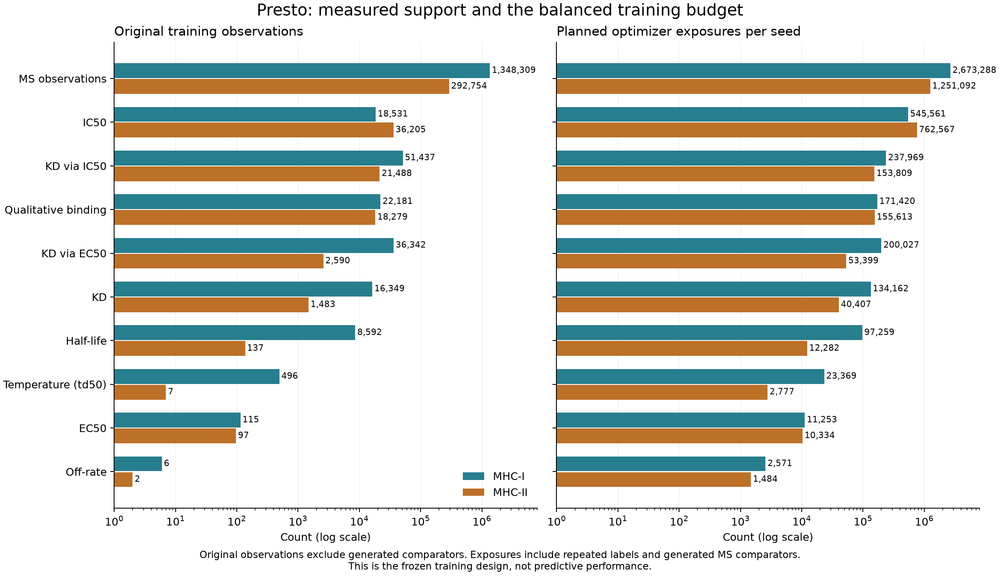

# Shared multi-output training and 2026 study holdouts

Status: **Both H100 fits are optimizing; first 1,000-update validation results available. Final validation/test verification remains pending.**
Agent/model: Codex / GPT-6. Date: 2026-10-28 UTC.

[Prospective specification](../agents/codex/plans/2026-10-28_temporal-multi-output.md)
· [live report](http://127.0.0.1:54502/dashboard.html)
· [canonical registry](../experiment_log.md).

## First validation checkpoint (provisional)

Both seeds completed their first 1,000-update validation on the same frozen older
study holdouts. These are worker-reported intermediate results, not final selected
checkpoint metrics or independently verified prediction dumps. Neither fit has
completed its 51,099-update weighted epoch; no test result or winner is claimed.

| Metric at 1,000 updates | Seed42 I | Seed42 II | Seed43 I | Seed43 II |
| --- | ---: | ---: | ---: | ---: |
| IC50 exact n | 141 | 1,129 | 141 | 1,129 |
| IC50 Spearman | 0.3731 | 0.3651 | 0.3926 | 0.3640 |
| IC50 Pearson | 0.4724 | 0.3601 | 0.4356 | 0.3603 |
| IC50 RMSE log10(nM) | 1.6523 | 0.8536 | 1.8519 | 0.9600 |
| Same-protein ligand AUROC | 0.9326 | 0.7592 | 0.9422 | 0.7597 |
| Same-protein ligand AUPRC | 0.6748 | 0.4329 | 0.7538 | 0.4046 |

The ligand comparisons contain 10,116 class-I and 4,152 class-II observations
including five generated unobserved comparators per positive parent. Their
constant-score AUPRC is 1/6; these comparators are not measured non-binders.
The two small class-I studies with source-reported positives and negatives are
considerably harder: seed42 AUROCs 0.5982 (53 rows) and 0.5619 (52 rows). All 141
class-I IC50 validation values are <=500 nM, so their threshold binding AUROC is
undefined. Rank and absolute calibration must both remain visible. This cohort
differs from previous development benchmarks and cannot establish a comparative
gain over those models.

[Machine-readable first-checkpoint comparison](results/provisional-first-validation.json)
and [CSV](results/provisional-first-validation.csv) link hashed worker snapshots;
the live report continues to advance. Exact staged manifest bytes are preserved
under `reproduce/manifests/`, verified against the pre-fit frozen contract.

At its second validation (2,000 updates), seed42 improves IC50 Spearman to
0.4350/0.4196 and same-protein ligand AUROC to 0.9368/0.7746 for I/II. IC50 RMSE
is 1.6785/0.8626: ranking improves without a corresponding calibration improvement.
The [second provisional snapshot](results/provisional-validation-s42-step2000.json)
is retained. Both hosted CI checks for the report source at `22860793` pass
(40823270821 and 40823252321); final predictive closure is still open.

## Source-review correction (2026-10-29)

The first two H100 calls were stopped during preflight with zero optimizer updates
and no held-out predictions. Primary-source review identified 20 unresolved kinetic
labels: six on-rates and fourteen off-rates. Their exact assay identities and primary
references are retained in the shared packaged `data/assay_measurement_reviews.json`
registry. The common purified-assay adapter defers them without inventing corrected
numbers. **Correction to an earlier review note:** half-life assay 1820987 already
has a `>` qualifier, consistent with the paper; all twelve half-life labels remain.

The original result and reproduction directories are frozen under
[attempts/source-as-exported](attempts/source-as-exported/archive.json). The revision
preserves every holdout, generated background and all other row bytes. It drops the
unsupported `kon` head; `koff` retains eight TRAIN labels and no held-out qualification.
CPU preparation passed the exact-delta, scale, quota and composition checks in 350.6 seconds.
Each replacement GPU still runs the full common trainer preflight before optimization.
The model, loss and optimizer implementation are unchanged. Source runtime commit:
`aa2b3f7a358010f1d6163cbaad7c28dd1e1fa97e` (213 pinned files).

The counts below describe the completed reviewed cohort. No scientific winner or
final primary recipe is claimed.

Both workers passed the unchanged common preflight (1,824.5 and 1,990.1 seconds),
matching the independently computed TRAIN scalers. Initial checkpoints and subsequent
optimizer progress are recorded; see `results/worker-preflight-verification.json`
and the live report. Repeated admission/dependency/sampler scans accounted for the
long CPU startup. Current source CI at `dc307af6` passes both hosted runs
40821271664 and 40821252677. The active H100 runtime remains the pinned `aa2b3f7a`.

After collection and independent verification, the existing continuation generates
`results/summary.md` with both seeds side by side: quantitative output/class/era
metrics, generated and source-reported ligand comparisons, 500 nM classification,
zero-support cells, actual exposures and selected/completed checkpoint coverage.
This readable report uses the verified tables and introduces no new inference or
selection. Fifteen existing reporting/metric/uncertainty fixtures and a separate
cross-seed rendering smoke check pass; these are software checks, not fit outcomes.

## Source and admission contract

Fresh canonical IEDB and CEDAR full exports were downloaded with Hitlist 2.0.40,
10,066,712,903 and 9,188,295,774 bytes respectively; see
[acquisition receipt](results/acquisition.json). The 5,208 source reference entries
include 45 distinct papers dated 2026, with PubMed publication-date XML retained.
A metadata-only inventory finds **no direct IC50, KD or EC50 measurements in those
2026 exports**. The user therefore authorized older whole-assay-study holdouts.
These are new from-scratch study splits, not claims that historical data were never
used in earlier architecture development.

Use canonical Hitlist indexing/export and the shared typed Presto adapters.
Admit unmodified peptides with resolved human MHC groove sequences from the pinned
mhcseqs catalog. Preserve every reported candidate MHC; do not assign a cognate
allele to a multi-allelic sample. Ordinary explicitly allele-resolved human DR may
use a declared DRA*01:01 reference, preserving original typing. Explicit partners,
construct exceptions, DP/DQ and unresolved serotypes retain stricter rules.
Molecular MHC species, antigen/source organism and experimental host are separate.
This is the compatible human-MHC cohort, not a claim to train on every raw export row.

Physical measurements remain distinct: IC50, KD, EC50, KD-via-IC50, KD-via-EC50,
half-life, off-rate, on-rate and td50. Literal qualitative binding and observed
elution are separate binary outputs. Bounds keep their original inequality;
training scales use exact TRAIN values only. Allocate only supported TRAIN heads.
Shared source implementation is pinned at `aa2b3f7a358010f1d6163cbaad7c28dd1e1fa97e`;
[complete runtime file hashes](reproduce/runtime-pins.json) include 213 files. The
model and trainer files match the original c8f032a7 runtime exactly.

## Frozen selection and model recipe

Prespecified 2026 test PMIDs: 41534530 (class-II MS), 42069060 (class-I MS),
42048449 (class-I KD-via-IC50); all three have eligible observations. A deterministic
metadata-count rule adds older assay studies for test and validation. Source-study
alias components remain whole; exact peptides are disjoint, with test > validation
> train priority. Final membership, exclusions and numerical budgets were frozen and independently
verified before any fit; see `results/partition-verification.json` and
`reproduce/training-contract.json`.

One shared-v5 wide 192/3/6/768 model and the canonical observation-manifest trainer,
seeds 42/43, no pretrained weights, dropout .1, AdamW 3e-4/decay1e-4, batch128.
Relative label frequencies: 60% elution,20% IC50,15% other physical outputs,5%
qualitative binding; within families, endpoint/class frequencies use square-root
counts. Canonical weighted quotas cover all unique TRAIN rows. The resulting budget is51,099updates per seed: one complete weighted epoch
of6,540,643examples, batch128 (final batch may be partial). Validate every1,000 updates;
equal-endpoint loss selects the checkpoint. Full validation/test dumps; a fixed
16,384-row cap applies only to post-fit TRAIN diagnostic predictions.

All outputs use the same peptide/groove encoder and full ordered ligand context.
Unsupported source-protein/cellular-context inputs are not allocated. Their source
annotations remain available for stratified reporting. This task does not qualify
native DO:DM, TCR or independently identified processing/detector mechanisms.

## Ligand comparison populations

Shared canonical backgrounds match positive length, MHC candidates, context and
study: one per TRAIN positive, five per evaluation positive, seed20261028, with
replacement. Use exact same-protein mapping when available, otherwise report the
frozen human Ensembl112 proteome population separately. Exclude all known positive
peptide sequences and other-split sequences. These are unobserved comparisons,
not measured non-binders. Report length-only controls and same-protein/fallback
AUCs separately. The complete positive blacklist includes held-out sources for
conservative background exclusion only.

Source-reported MS negatives are retained as **assay-scoped nondetections**, with
study-specific AUCs separate from generated backgrounds. A large historical source
is HLA-B27 transgenic rat/ERAP1 data, so human MHC must not be relabeled as human
host or a universal non-presentation claim. Mixed/unknown conditions remain explicit.

## Execution and verification

Source preparation: CPU8,96GiB RAM. Attempt2 failed at Hitlist's default16GiB
provenance scratch limit; raw downloads survived. Attempt3's explicit256GiB disk
request was rejected before a worker started. Attempt4 asserts128GiB scratch,
16GiB reserve and512GiB requested ephemeral disk. All attempt receipts/logs are
preserved. Dropped local log/controller connections do not restart the remote build.

Predictive resources: requested `H100!`, maximum two workers, CPU8/64GiB RAM each.
The original workers reported NVIDIA H100 80GB HBM3,85,009,367,040device bytes, Torch2.14.1+cu130,
CUDA13.0; TF32/AMP/compile disabled. Fit runtime and held-out metrics remain pending.
There is no preferred new checkpoint yet.

Software evidence: the final full shared suite passed **2,854 tests/four skips**
in 327.09 seconds; 112 focused source checks and 37 family fixtures pass. The earlier
the literal purified-method and reported-MS-negative admission checks passed79
and89 focused tests, respectively. Preparation/report/controller/recovery fixtures passed before launch,
including the real ObservationIndex/common-trainer preflight, independent source/background audit and separation of
reported-negative versus generated-background AUCs. Artificial tests are not
biological performance evidence.

## Reproduction and artifacts

- `code/acquire.py`, `build_index.py`, `admit.py`: canonical source stages.
- `code/partition.py`, `prepare_worker.py`, `prepare.py`: fixed cohort preparation.
- `code/launch.py`, `worker.py`: two-seed common-trainer fits and live validation.
- `reproduce/`: source snapshots, exact invocations, failed-attempt dispositions,
  dependency call IDs and pinned package/reference hashes.
- Modal volume `presto-checkpoints`, `/volume/2026-10-28_1540_codex_temporal-multi-output/`:
  original sources and preparation; revised manifests and fits are under
  `revisions/kinetic-review-v2/`. `/runs/` paths are worker-local staged copies.
- Local large artifacts: repository `artifacts/2026-10-28_1540_codex_temporal-multi-output/`.

Final closure still requires: all fits, complete validation/test prediction dumps,
independent metric/source checks, selected-checkpoint TRAIN-probe serving replay,
per-output/class/study summaries and uncertainty, canonical registry/model-reference
updates and the shared recipe handoff. PR131 stays draft pending scientific gates.

## Fresh source build and admission progress

The full canonical build completed at 2026-10-28 17:58 UTC, yielding 5,844,451 MS,
821,470 binding and26,694 other-assay rows. The source inventory is large (298.8MB)
and lives at the hashed location in `results/source-inventory-location.json`.
The canonical upstream build excludes class-II peptides shorter than12 residues,
including150,931 MS and3,273 binding rows. This is an upstream curation policy,
not a claim that shorter class-II ligands cannot bind.

Admission attempt4 failed during remote launcher import, before data processing;
local filesystem upload paths are now constructed only locally. All three
launchers passed remote-path import checks. Attempt6 completed against the source build with the verified attempt5 database backup.
Admission retained2,023,956 original observations:263,432 physical/qualitative
measurements and1,760,524MS observations. Direct IC50 I/II counts before partitioning
are19,167/38,543;279,583rows across all outputs use declared reference DRA.
The complete receipt is `results/admission.json`.

The source also contains468,548 high-throughput multiplexed binding records not
covered by the frozen soluble-affinity/qualitative-purified adapter. Of these,
418,890 are the peptide microarray study PMID32903714; its exported labels are
not numerical affinity measurements. Other display-based studies share the broad
method label. See `results/multiplex-assay-inventory.json` and
`results/unsupported-assay-inventory.json`. A future typed microarray/display
readout must preserve its measurement scope instead of converting it to IC50.
Primary source: https://pubmed.ncbi.nlm.nih.gov/32903714/ ; source assay metadata:
https://www.iedb.org/assay/17059219 . These rows are explicitly excluded from the
current frozen admission contract, not silently counted as trained examples.

## Earlier operational evidence (historical)

As of2026-10-28 19:11 UTC, source build and the binding/other-assay passes are
complete. The canonical human MS export contains5,440,009rows. Attempt5's measured
rate of306rows/s would exceed its four-hour limit. A consistent read-only SQLite
backup was committed to the volume before stopping that worker. The2.57GB backup
contains406,381retained rows and1,703,850known-positive sequences; its exact hash
and receipt are in `results/admission-local-recovery-backup.json`.

Attempt6 uses512GiB worker-local disk and a1GiB SQLite page cache, replaying the
same source rows through the unchanged scientific adapters. All406,381snapshot
rows matched byte-for-byte. Counters and per-row dispositions are regenerated;
status counts are never used as a transactional resume ordinal. The metadata-only
vocabulary pass projects14fields, while actual admission retains all161fields.
The recent MS processing rate was about1,460rows/s. At19:11UTC925,696MSrows had
been checked. Active call: `fc-01M61Y051TV4HX19H6F0W50P6N`, app
`ap-i9Xi2zCOm6fs7EnhbbEF1a`. Completed replacement artifacts will preserve attempt5
in a separate directory. The earlier stage-guarded backup attempt created nothing;
its failed receipt remains alongside the successful later backup.

The queued preparation controller depends on attempt6. Local DNS failures are
retried with bounded saved-call polling; genuine remote timeouts, source hash
mismatches and disk failures still fail immediately. Profiling found a costly
full-column Arrow conversion but did not establish its relationship to heartbeat
transport failures. Diagnostic receipts, original snapshots and logs are retained.

`code/advance.py` owns the local continuation lock. It waits for the queued
`code/prepare.py` call, requires its independent audit, freezes the exact contract,
launches at most two H100! fits, collects hash-verified artifacts, freezes seed
selection from validation only, and checks saved predictions with independent
SciPy/sklearn calculations. It does not mark the scientific writeup complete.
The selected checkpoint is also replayed through guarded public serving on TRAIN
probes only. Final scientific interpretation and common-recipe promotion remain open.

Preparation and GPU workers use512GiB requested local disk for indexed reads,
with the same canonical manifest paths and hashes; completed datasets and fit
outputs are durable on the Modal volume. This changes no rows, model code or
numeric precision. `results/ci-2f6f1ca8.json` records passing CI for the pushed
shared-source/experiment commit; PR131 remains draft.

## Verified cohort and active fits

Preparation call `fc-01M627VM7J2SPPR71V2MRSHT08` completed after Modal preempted
its first CPU container and automatically retried the same input. A closed-file
materialization backup was also committed, with hashes in
`results/materialization-backup-completed.json`. The completed cohort passed both
canonical preflight and independent original-target, study-alias, exact-peptide,
background-lineage/blacklist/ratio and TRAIN-scale checks. No duplicate preparation
was submitted. The verified audit removes127,096original rows by peptide embargo.

| Partition | Original observations | Generated comparators | Total rows |
|---|---:|---:|---:|
| TRAIN | 1,875,400 | 1,617,732 | 3,493,132 |
| Validation | 6,534 | 12,050 | 18,584 |
| Test | 14,906 | 59,250 | 74,156 |

TRAIN includes54,736direct IC50 measurements (18,531I/36,205II),17,832KD,212EC50,
72,925KD-via-IC50,38,932KD-via-EC50,8,729half-life,8koff,503td50,
40,460qualitative binding and1,641,063original MS observations. Every allocated
output has TRAIN support, but koff has no eligible held-out observations;
it is an unvalidated output, not evidence of generalization. Some other
output/class cells have no validation or test support; retain explicit N/A.
All molecular MHC is human; experimental hosts and peptide organisms vary.
`results/cohort-strata.json` (with its verified 20-row delta receipt) preserves method, host, source organism, peptide
length, candidate count and reported allele counts on original observations.
Reported-allele membership counts can overlap for multi-allelic observations.

[Reviewed Modal app](https://modal.com/apps/iskandr/main/ap-vGJZSwosZm8VkhOcNJPonj):
seed42 call `fc-01M62XMCM816XJJJT29A62VV67`;
seed43 call `fc-01M62XMCQ63CRJ69VFR96TX0MW`.
The exact invocation and dirty state are in `reproduce/launch.json`; scientific
runtime is the 213-file aa2b3f7a snapshot. Experiment observer state is bound
atomically to common resumable model/optimizer/RNG/order/evaluation checkpoints.
Three interruption tests establish exact restored weights, optimizer, coverage and
evaluation-cache reuse on artificial CPU fixtures. Recovered elapsed/optimizer
seconds exclude rolled-back work; per-attempt GPU peaks are not total paid compute.

The local dashboard poller now has a30-second remote-read deadline and retains
last-known evidence with an explicit poll error. It does not resubmit jobs.
Validation appears every1,000updates; test reporting remains behind the saved
validation-only selection and independent-prediction-verification gates.

## Canonical allele composition audit

The initial raw-metadata table has reported-candidate allele counts for MS but
lacks the analogous physical-assay provenance field. A supplemental read-only
audit now counts canonical catalog alleles for every original observation,
preserving class-II paired candidates separately from their allele union.
`results/cohort-composition-verification.json` reconciles every original
split/endpoint and every total split/endpoint/class count with frozen preparation.
Individual allele memberships may overlap; observation totals never do.

Original TRAIN MS counts are 1,348,309 class I and 292,754 class II. Direct IC50
counts are 18,531 and 36,205. Class-I IC50 includes 5,880 HLA-A*02:01 observations.
Full original support, catalog allele memberships, candidate sets, studies and
qualifiers are in `results/cohort-composition.json`. The initial metadata audit ran in
existing worker `ta-01M62SMMGKXEEGYE67SFBSRR3R`. The complete audit was rerun on
the corrected CPU cohort without model evaluation. Both source/invocation records
are preserved, with the original under `attempts/source-as-exported/`.

The figure describes the frozen sampling design, not predictive performance.
PNG/PDF and the exact plotting invocation are preserved; actual optimizer
exposures and selected-checkpoint coverage will be reported after fitting.

## Original-observation support by output

Counts include exact and bounded original outcomes, excluding all generated
comparators. A zero means that output/class cell has no observations in the split.

| Output | TRAIN I / II | Validation I / II | Test I / II |
|---|---:|---:|---:|
| ec50 | 115 / 97 | 69 / 0 | 70 / 107 |
| elution_observation | 1,348,309 / 292,754 | 1,748 / 694 | 5,305 / 6,611 |
| half_life | 8,592 / 137 | 71 / 0 | 62 / 148 |
| ic50 | 18,531 / 36,205 | 141 / 1,129 | 100 / 379 |
| kd | 16,349 / 1,483 | 532 / 0 | 449 / 30 |
| kd_via_ec50 | 36,342 / 2,590 | 106 / 422 | 66 / 339 |
| kd_via_ic50 | 51,437 / 21,488 | 96 / 246 | 604 / 55 |
| koff | 6 / 2 | 0 / 0 | 0 / 0 |
| qualitative_binding | 22,181 / 18,279 | 689 / 446 | 290 / 151 |
| td50 | 496 / 7 | 145 / 0 | 140 / 0 |

## Source concentration before fitting

Original TRAIN observations are 87.5% MS and 2.9% direct IC50; the fixed sampler
assigns 60% and 20% of optimizer labels respectively. Sampling balances endpoints
and classes, not source studies. IC50 spans 132 class-I and 213 class-II reference
components, but the largest contributes 47.8% and 47.4% respectively. Class-II MS
has 67 components; the largest supplies 51.4%. Reference components can include
unpublished IEDB submissions, so component counts are not all peer-reviewed papers.

The test IC50 set has one class-I study (100 observations) and three class-II
studies (379 observations, including bounds). Class-II test MS is one 2026 study;
class-I test MS is two studies, dominated by its 2026 paper. These are deliberately
small study holdouts, not broad estimates across future studies. Report per-study
metrics and conditional uncertainty alongside pooled numbers. Exact counts and
source aliases are in `results/study-concentration.json` / `.csv`.
