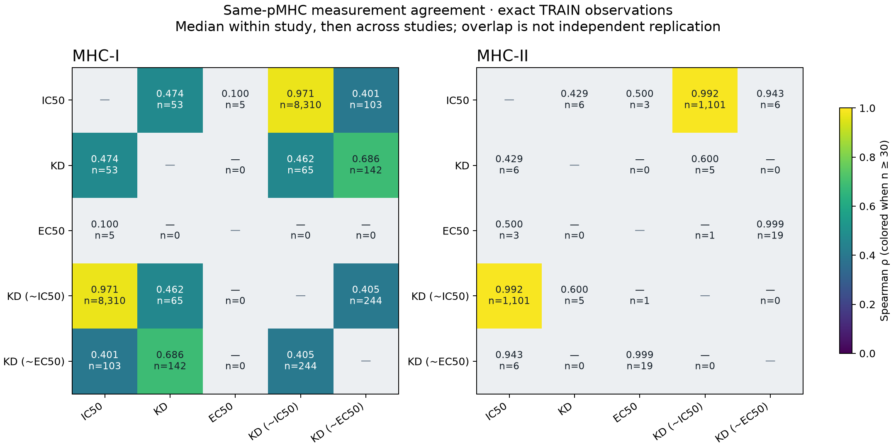

# Affinity assay agreement, ranking and shared binding geometry

Date: 2026-10-29. Agent/model: Codex / GPT-6.
**Phase A complete and verified; subsequent training experiments remain pending.**
[Detailed specification](../agents/codex/plans/2026-10-29_affinity-objectives-geometry.md).

First stage: descriptive agreement between the five quantitative concentration
outputs on identical TRAIN pMHCs from the corrected temporal cohort. This is a
measurement audit, not a predictive evaluation; validation/test are deliberately
unused, and no prediction dump applies to this stage. No pretraining, model fit,
loss, synthetic labels or GPU is involved. Original bounds are counted but
excluded from ordinary correlations. Same-pMHC duplicates are aggregated within
study before pooling, and within-study/disjoint-study scopes remain distinct.

Inputs: the nine-source frozen seed42 manifest in
`../2026-10-28_1540_codex_temporal-multi-output/reproduce/manifests/`, with corrected
physical TRAIN source on Modal volume `presto-checkpoints` under
`2026-10-28_1540_codex_temporal-multi-output/revisions/kinetic-review-v2/prepared/`.
The audit records exact source SHA256s and retains aggregate pairs for independent
recomputation. Reproduction source/command were frozen under `reproduce/` before launch;
large raw artifacts stay in the named Modal family directory and local `artifacts/`.

Later stages qualify ranking panels, implement common schedule/ranking/geometry
options, measure shared gradient interference and run matched predictive controls.
Exact conditions and test contract must be frozen before those stages launch.
At most two H100! workers concurrently; current temporal fits stay unchanged.

## Measurement labels and actual assays

These are five source measurement labels, not five independent experimental
technologies. `KD (~IC50)` means an IC50-based approximation to KD, not an IC50
derived from measured KD. Likewise `KD (~EC50)` is EC50-based. Literal KD rows
mostly carry competitive assay methods; calling them all "direct KD" was wrong.

| Output | TRAIN rows | Exact rows | Actual method census |
|---|---:|---:|---|
| IC50 | 54,736 | 49,732 | Competitive: 44,442 radioactivity; 10,294 fluorescence |
| KD | 17,832 | 5,546 | Competitive: 16,367 fluorescence; 1,464 radioactivity; direct radioactivity: 1 |
| EC50 | 212 | 199 | Direct fluorescence: 212 |
| KD (~IC50) | 72,925 | 67,967 | Competitive: 71,749 radioactivity; 1,176 fluorescence |
| KD (~EC50) | 38,932 | 12,789 | Direct fluorescence: 38,932 |
| Total | **184,637** | **136,233** | **48,404 bounds excluded from ordinary correlations** |

All are admitted human purified-MHC binding observations. No cellular activation
EC50, TCR binding, mass-spectrometry label or synthetic background is included.
The full physical source contains 234,337 rows: the other 49,700 are 40,460
qualitative binding, 8,729 half-life, 503 TD50 and 8 koff observations.
Source-row counts do not establish independent experimental outcomes.

IC50 measures half-maximal competitive inhibition; binding EC50 measures a
half-maximal binding response. KD is an equilibrium dissociation constant, but
the response label alone does not prove how it was inferred or that experimental
conditions satisfy the approximation. Primary definitions and source examples:
[IEDB benchmark paper](https://pmc.ncbi.nlm.nih.gov/articles/PMC4481849/),
[competitive KD-labelled record](https://www.iedb.org/details_v3.php?id=1718261&type=assay),
[IC50-as-KD convention](https://www.iedb.org/details_v3.php?id=1019164&type=assay).

## Same-pMHC agreement

Match exact peptide, both modeled groove sequences and MHC class. Take median
log10(nM) within pMHC/endpoint/study, then median across studies. Each pMHC gives
one pair below. Bounds are excluded; replicates never form Cartesian pairs.
Constructs and conditions outside the modeled identity can differ. These are
measurement correlations, not model prediction scores.

| Measurement pair | MHC-I Spearman (n) | MHC-II Spearman (n) |
|---|---:|---:|
| IC50 / KD | .4742 (53) | .4286 (6) |
| IC50 / EC50 | .1000 (5) | .5000 (3) |
| IC50 / KD (~IC50) | **.9709 (8,310)** | **.9915 (1,101)** |
| IC50 / KD (~EC50) | .4006 (103) | .9429 (6) |
| KD / EC50 | unavailable (0) | unavailable (0) |
| KD / KD (~IC50) | .4624 (65) | .6000 (5) |
| KD / KD (~EC50) | .6864 (142) | unavailable (0) |
| EC50 / KD (~IC50) | unavailable (0) | undefined (1) |
| EC50 / KD (~EC50) | unavailable (0) | .9987 (19) |
| KD (~IC50) / KD (~EC50) | .4045 (244) | unavailable (0) |

Tiny overlaps cannot establish assay equivalence or disagreement. Same-study
comparisons total only eight pMHC/study pairs across all output pairs, and same
study itself does not verify matched conditions. Most agreement is cross-study;
method, lab, MHC, range restriction and cohort effects remain entangled.

All 60 class/output/scope cells, including Pearson, signed log offset, difference
RMSE, exact-value equality and study counts, are in
[correlations.csv](results/assay-agreement/correlations.csv). Scopes: same study,
pooled pMHC, and disjoint endpoint study sets. Different component IDs do not
establish independent measurement provenance.

## Source dependence and interpretation

IC50/KD(~IC50) values agree within 10% for 94.27% of class-I and 97.18% of class-II
shared pMHCs. The largest IC50 study contributes 7,523/8,310 (90.5%) and
1,024/1,101 (93.0%) overlaps respectively. Excluding those components gives:

| Exploratory sensitivity | MHC-I | MHC-II |
|---|---:|---:|
| Remaining shared pMHCs | 787 | 77 |
| Remaining Spearman | .7772 | .8615 |

The dominant components are PMID19734234 and PMID26195744. Several overlap groups
pair publications with related database submissions. A source-attested example:
the Timothy-grass submission IEDB1019527 explicitly references PMID20554959
([source description](https://www.iedb.org/assay/2426623)). Such observations
should not automatically be counted as independent replication. The class-II
EC50/KD(~EC50) overlap also has 18/19 exactly identical aggregate values.
Neither matching values nor separate assay accession IDs proves independence.
The exploratory sensitivity does not certify remaining pairs as independent.

**Decision:** test shared affinity representations with method-aware calibration
and better lineage weighting, preserving original labels. These data do not
justify blindly merging all five outputs or declaring output-head conflict.
Current training data, architecture, sampler and running fits remain unchanged.

## Execution and verification

- Git parent `0d96d801d0ad8c9ebd8682a5db0de812200ba674`, dirty state recorded at
  launch. Executed source is frozen in `reproduce/source/`.
- Exact source: `hitlist-v4-iedb-train.jsonl` at the Modal path above,
  1,048,903,442 bytes; SHA256
  `c76aeafbb47c66b7fa904c191502de95f8812d45275cdfe680821838a37200b1`.
  Parent seed42 manifest SHA256
  `5541024b53ce7d09ef6779639eb9fb1b7fd2f72c770f84ba311a5b294053b9a1`.
- Launch with `python -m modal run --detach` followed by this family's
  `code/audit.py`, then `code/lineage.py`. Exact invocations, environment and
  hashes are in `reproduce/launch.json` and `reproduce/lineage-launch.json`.
  Launchers reject duplicate calls/results; a new rerun needs a declared attempt.
- CPU only: 4 requested CPUs; 16,384 MiB audit / 8,192 MiB lineage. No GPU used.
  Audit Python 3.12.1, NumPy 2.5.4, SciPy 1.18.1. Source scans: 25.75 s and
  22.53 s, excluding startup/archive. No pretraining, fit, loss or synthetic data.
- Apps: [agreement](https://modal.com/apps/iskandr/main/ap-RPoCP4I24QAgAhrlM2jokV),
  [lineage](https://modal.com/apps/iskandr/main/ap-5CbAg63HJGJASISXDdspmU).
  Call IDs in `reproduce/*call.json`; launch logs under `launch_logs/`.
- Archive sizes/hashes verified. **60 correlation cells** recompute independently
  using NumPy Pearson and average ranks. An independent second source scan
  preserves **21,083 overlap records** without sequences, from which all
  **40,252 aggregate sides** recompute. Five synthetic aggregation/integrity tests
  pass. No original assay identity occurs under conflicting output labels.
- `results/assay-agreement/`: 20,126 preserved paired records, summary JSON,
  method census, correlations and repeat spreads. `results/overlap-lineage/`:
  original overlap values and study metadata. `results/agreement-interpretation.json`:
  sensitivity/aggregation verification. Plots: `results/assay-agreement.png/.pdf`.
- Archives are under repository `artifacts/2026-10-29_1318_codex_affinity-objectives-geometry/`
  and the same family on Modal volume `presto-checkpoints`. No validation/test
  use: descriptive TRAIN audit only; predictive losses/threshold metrics and
  prediction dumps do not apply. Existing temporal GPU fits keep their own pins.

Status: Phase A closed; predictive schedule/ranking/geometry phases pending.
Next step: qualify panels/lineage and freeze matched predictive comparisons.
Open questions: independent matched assays, redundant measurement weighting,
gradient interference versus exposure, and common binding geometry.
