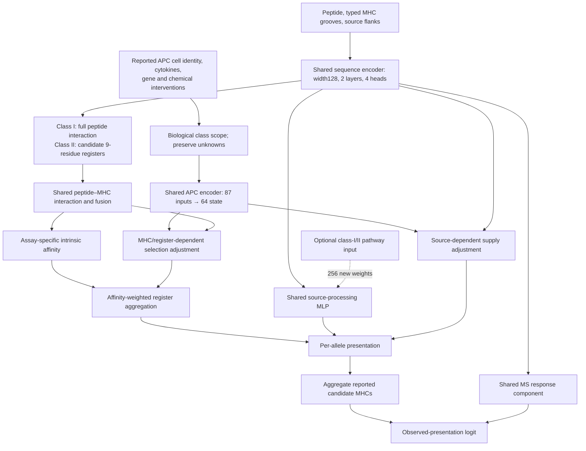

# Current shared presentation model

The same checkpoint and public predictor handle class I and class II. Sequence, affinity, source processing, APC state and measurement modules train jointly. No supported parameter is frozen. NetMHCpan and NetMHCIIpan are evaluation comparators, not inference dependencies or TRAIN-label generators.

The source implementation is frozen at`5f9bfe37` in`reproduce/runtime-pathway/`. The first six predictive fits use`2da11504`; the optional pathway feature is absent there. Historical checkpoints load with unchanged outputs when that option is disabled.

## What the state contains

Expanded TRAIN supplies23 cell-type categories,31 named intervention factors and IFNG. Cell identity uses23 inputs; each exposure has separate present/absent inputs, giving87 columns in total. Unknown exposure activates neither column. These inputs feed one bias-free87→64 encoder with a tanh nonlinearity. The same state encoder, source-dependent supply map and MHC-dependent selection map are used for both classes.

Before encoding, class masks restrict direct biological scope. For example, the CIITA intervention column is inactive on class I, and the B2M/TAP columns are inactive on class II. This is an explicit pathway prior, not a learned quantitative effect estimate. Common cell/cytokine/drug inputs can reach both pathways; actual concurrent source annotations are retained. A gene intervention is not converted into an invented expression fold change.

The supply adjustment is a dot product between the APC state and an encoded peptide/source projection. Selection uses a dot product between the same state and each peptide–MHC/register projection. Missing APC state gives zero APC adjustment. Intrinsic affinity never takes APC inputs, but presentation gradients can update its shared parameters during end-to-end training. This separates input meaning without freezing learning.

The canonical schema also supports measured component activity and cytokine dose/duration when units and training support exist. These fits have no quantitative expression targets, so that capability must not be advertised as validated expression-conditioned prediction.

## Processing and class differences

The full peptide and source flanks feed one processing MLP. The optional follow-up adds a zero-initialized2→128 class projection before that MLP's nonlinearity. It adds256 weights, preserves parent predictions at initialization, and allows the shared processor to respond differently to class I and II. The source encoder, MLP weights and output remain shared. The two-seed comparison found negligible predictive benefit over the same shared-state model with this option off, so the preferred checkpoint leaves it off.

Class II enumerates candidate nine-residue registers and pools the configured intrinsic-affinity scores with normalized log-sum-exp. APC selection adjusts register contributions. Class I uses its full peptide interaction. Typed candidate MHC sets are retained, deduplicated by biological sequence identity, and their presentation logits are combined with normalized log-sum-exp. No arbitrary best allele is assigned to an observed peptide. No register-orientation/pooling change is made in this experiment.

The final observed-presentation output includes an MS response term and an observation offset. It ranks source MS detections against declared sampled backgrounds. The named processing, supply and selection terms are useful diagnostics, but these labels alone do not independently identify biological processing rates or absolute surface abundance.

## What the controls mean

- **No APC:** an independently trained model with the APC module absent, under the same data/optimizer/selection contract.
- **Shared APC:** the width64 module participates in joint training using supported reported state.
- **APC unknown:** inference on a fixed trained model after removing APC assertions; this is missing information, not an untreated control.
- **APC shuffled:** inference with whole observed APC signatures permuted among pairs within study/class. Both pair members keep the same donor signature; peptide flanks and all non-APC inputs stay unchanged.

No-APC versus shared-APC fits test an incremental predictive association. Unknown/shuffled inference checks sensitivity to state. Neither establishes isolated drug effects or calibrated loss of presentation after B2M/TAP knockout; clean arm comparisons or quantitative targets are still needed for those claims. See the source-support audit and the Hitlist curation tracker linked from the README.
